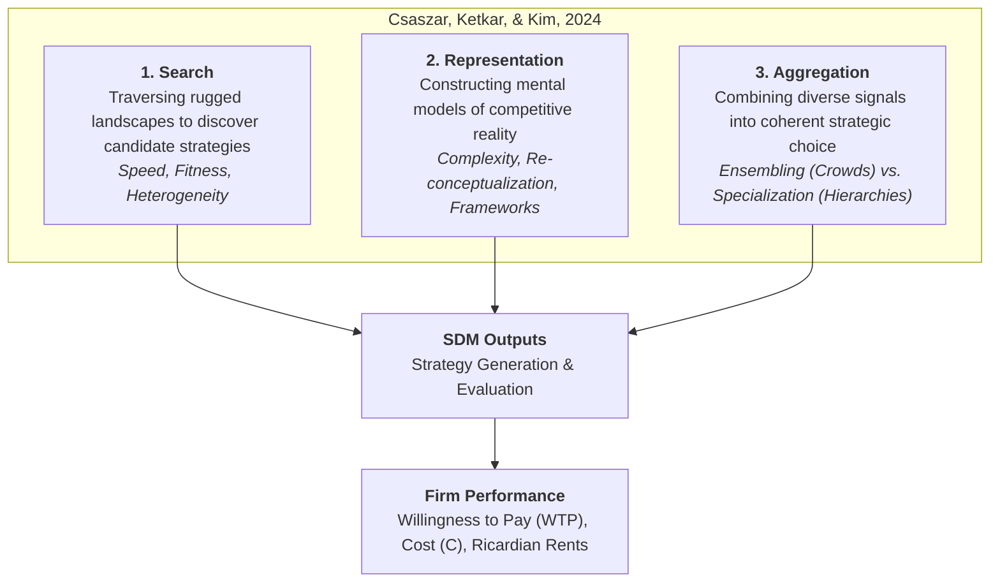
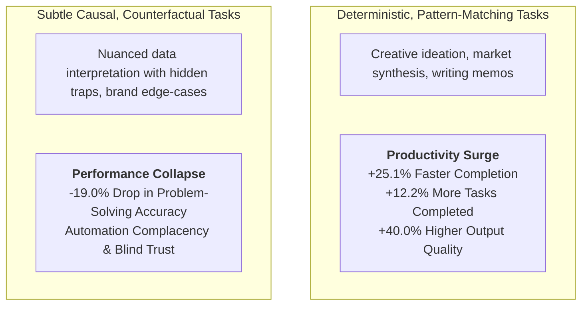
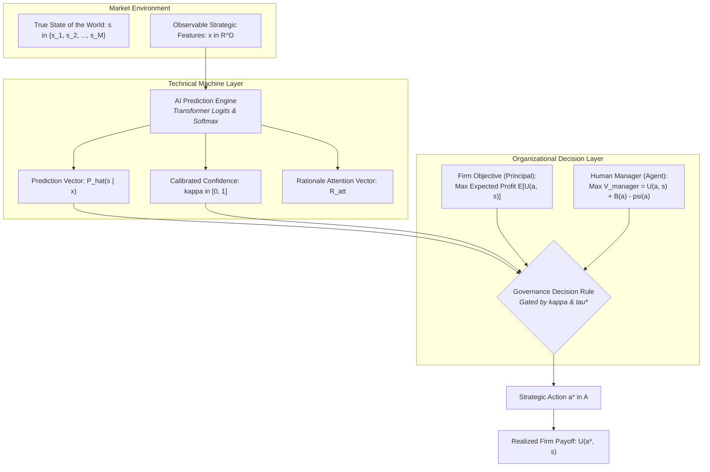
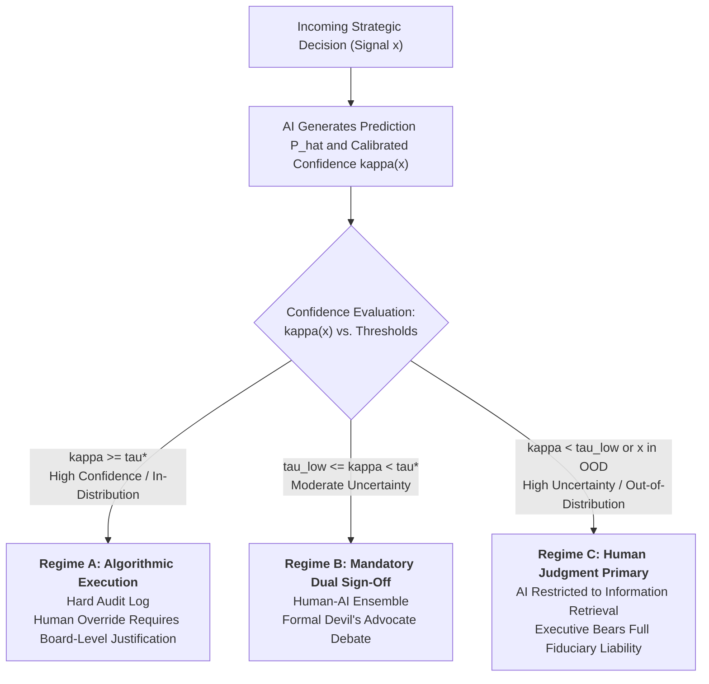
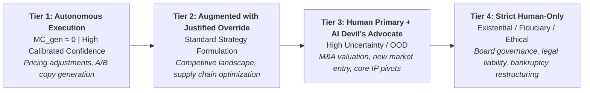

# The Economics of Decision Authority in AI-Augmented Strategic Decision-Making: Probabilistic Prediction, Agency Costs, and Optimal Governance Guardrails

**Course:** Business Economics (BE)  
**Discipline:** Information Technology & Business Economics  
**Author:** Advait Surendra Mulmule  
**Date:** September 2026  

---

## Abstract

This paper examines the microeconomic consequences of integrating Artificial Intelligence (AI)—specifically large language models (LLMs) and probabilistic machine learning systems—into firm strategic decision-making (SDM). While conventional business economics models treat technology as an exogenous productivity shock that uniformly shifts the firm's production frontier, and computer science treats AI alignment as a purely algorithmic optimization problem, this study bridges both domains by investigating the **allocation of decision authority** between human managers and algorithmic agents. 

We synthesize empirical evidence from five foundational studies: the base field evaluation of LLM strategy generation and venture capital screening (*Csaszar, Ketkar, & Kim, 2024*); the multi-department investigation of managerial override and algorithmic returns (*Kim, Glaeser, Hillis, Kominers, & Luca, 2024*); the randomized controlled trial (RCT) establishing the "jagged technological frontier" across elite consultants (*Dell'Acqua et al., 2024*); the 5-month entrepreneurial field RCT in Kenya documenting severe performance divergence (*Otis et al., 2024*); and the foundational economic unbundling of prediction and judgment (*Agrawal, Gans, & Goldfarb, 2018, 2024*).

We introduce a formal microeconomic decision model that decomposes strategic choice under uncertainty into probabilistic prediction vectors, state-dependent payoff matrices, and managerial private utility functions characterized by agency costs, status-quo bias, and career-risk apprehension. We demonstrate mathematically why **unconstrained managerial discretion** systematically destroys algorithmic returns through biased overrides, while **unconstrained algorithmic delegation** exposes the firm to asymmetric, catastrophic downside risk outside the model's capability frontier due to confidence miscalibration and the absence of causal world models. 

To resolve this economic tension, we formulate an **optimal threshold-gated governance mechanism** ($\tau^*$) that conditions decision authority on the model's calibrated uncertainty metric and token-level rationale transparency. We conclude with a practical governance playbook for technology executives, founders, and enterprise architects, providing concrete implementation rules to maximize algorithmic returns while safeguarding against organizational failure.

**Keywords:** Artificial Intelligence, Strategic Decision-Making, Decision Authority, Principal-Agent Theory, Bounded Rationality, Jagged Technological Frontier, Algorithmic Governance, Absorptive Capacity.

---

## 1. Introduction

### 1.1 General Overview: The Unbundling of Decision-Making in the AI Era
Strategic decision-making (SDM)—the process of identifying, formulating, evaluating, and committing to long-term courses of action that determine a firm's survival and competitive positioning—has historically been viewed as the quintessential human endeavor (Csaszar et al., 2024). Rooted in executive intuition, deep domain experience, and tacit understanding of market dynamics, strategy has resisted traditional computational automation. Whereas quantitative, high-frequency domains like financial trading underwent near-total algorithmic transformation over the past three decades—with algorithmic execution now accounting for over 78% of U.S. equity market volume (Securities and Exchange Commission, 2020)—strategic management remained insulated because its primary inputs and outputs are open-ended, ambiguous, qualitative, and textual.

The rapid emergence and enterprise adoption of Large Language Models (LLMs) and generative artificial intelligence (GenAI) have radically dismantled this barrier. Trained on multi-trillion-token corpora encompassing vast repositories of business history, competitor analyses, industry trade reports, and academic strategy frameworks, modern foundation models exhibit emergent capabilities in synthesis, logical deduction, scenario simulation, and qualitative reasoning (Wei et al., 2022; Bubeck et al., 2023). 

From a microeconomic perspective, as formulated by Agrawal, Gans, and Goldfarb (2018, 2024), artificial intelligence is fundamentally a **technological shock that dramatically reduces the marginal cost of prediction**. In economic terms, prediction is the ability to take information you have (data) and generate information you do not have (a forecast of states of the world). When the unit cost of prediction approaches zero ($P_{\text{prediction}} \to 0$), classical demand theory dictates two immediate economic consequences:
1. **Direct Effect**: The quantity demanded of prediction expands exponentially, causing prediction to be integrated into domains where it was previously economically unfeasible (e.g., product ideation, competitor response forecasting, customer persona simulation).
2. **Complementary Effect**: The economic value of complementary inputs rises dramatically. The chief economic complement to prediction is **human judgment**—the capacity to assign payoffs, articulate utility functions, determine organizational objectives, and bear legal/ethical accountability under genuine Knightian uncertainty (Knight, 1921).

### 1.2 Different Views on AI in Management: Flawless Oracle vs. Opaque Liability
As enterprises integrate AI into their operational and strategic workflows, two polarized perspectives have emerged within management theory and corporate practice:

*   **The Technocratic Technologist View (The "Flawless Oracle")**: Proponents of full algorithmic delegation argue that human executives are severely constrained by cognitive limitations, bounded rationality (Simon, 1955), and pervasive psychological biases. Decades of behavioral strategy research document that managers suffer from confirmation bias, overconfidence, sunk-cost fallacy, status-quo inertia, and social inhibitions such as "sugarcoating" bad news (Fang, Kim, & Milliken, 2014) and evaluation apprehension (Reitzig & Maciejovsky, 2015). Under this view, automated AI decision pipelines eliminate human cognitive bottlenecks, optimize multi-dimensional trade-offs at machine speed, and should ideally be granted autonomous decision authority to maximize firm efficiency.
*   **The Skeptical Institutionalist View (The "Opaque Liability")**: Conversely, organizational theorists and economists aligned with the Theory-Based View (TBV) of strategy argue that LLMs and deep learning models are fundamentally incapable of genuine strategic thought (Felin & Zenger, 2009, 2017; Felin & Holweg, 2024). They point out that transformer architectures are fundamentally statistical pattern recognizers trained on historical data. Consequently, they optimize for the most probable continuation of existing text rather than generating the contrarian, idiosyncratic, forward-looking causal theories necessary to capture economic rents. Furthermore, deep neural networks operate as non-transparent "black boxes," prone to hallucination, sycophancy, and severe out-of-distribution fragility, rendering full delegation a catastrophic corporate liability.

### 1.3 Problem Statement: The Algorithmic Override Paradox
Recent empirical evidence demonstrates that neither extreme captures organizational reality. Instead, an intriguing economic paradox has emerged: **even when predictive algorithms achieve demonstrably superior statistical accuracy over human decision-makers, their organizational deployment frequently yields zero improvement in firm performance** (Kim, Glaeser, Hillis, Kominers, & Luca, 2024). 

Why does superior technical accuracy fail to translate into economic value? 

As documented by Kim et al. (2024) across 55 public and private departments, the breakdown occurs at the **interface of decision rights**. In almost all enterprise deployments, human managers retain ultimate "decision authority"—the right to accept, modify, or completely override algorithmic recommendations. Crucially, managers systematically exercise this override authority in ways that degrade final outcomes, driven by misaligned private incentives, defensive career preservation, or flawed personal heuristics. 

Simultaneously, field experiments reveal that when managers or workers do follow AI recommendations uncritically, they fall prey to **automation complacency**—"falling asleep at the wheel" and accepting disastrously erroneous advice on tasks that fall just outside the model's invisible capability frontier (Dell'Acqua et al., 2024; Otis et al., 2024).

### 1.4 Research Questions and Paper Roadmap
This paper directly addresses this critical intersection of computer science architecture and microeconomic theory by investigating three core research questions:

1.  **Research Question 1 (The Agency Mechanism)**: How do managerial private utility functions, status-quo biases, and career-risk incentives interact with algorithmic predictions, and why does unconstrained human override authority destroy the economic returns to artificial intelligence?
2.  **Research Question 2 (The Capability Boundary)**: How do the specific technical mechanics of modern AI—probabilistic inference, confidence miscalibration, and the lack of causal world models—generate the "jagged technological frontier," and what is the resulting distribution of economic losses under asymmetric payoffs?
3.  **Research Question 3 (The Governance Solution)**: What is the optimal microeconomic design of decision authority in the firm, and how can threshold-gated governance mechanisms, grounded in calibrated model uncertainty and rationale transparency, reconcile human judgment with machine intelligence?

The remainder of this paper is structured as follows: Section 2 synthesizes the theoretical foundations and audits the five core empirical reference papers. Section 3 introduces our formal conceptual framework and microeconomic decision model. Section 4 presents the analytical results and econometric synthesis. Section 5 outlines a comprehensive strategic governance playbook for technology executives and enterprise designers. Section 6 concludes with theoretical contributions and future research directions.

---

## 2. Literature Review & Theoretical Foundations

### 2.1 Bounded Rationality and the Behavioral Theory of the Firm
The intellectual foundation of strategic decision-making resides in Herbert Simon’s concept of **bounded rationality** (Simon, 1947, 1955). Classical neoclassical economics assumes an optimizing agent possesses complete information, infinite computational capacity, and well-ordered, stable preferences. Simon refuted this paradigm, demonstrating that human decision-makers face severe physiological and neurobiological constraints on information acquisition, memory retention, and computational calculation. Consequently, managers do not optimize; they **satisfice**—selecting the first alternative that meets a predetermined aspiration threshold.

March and Simon (1958) and Cyert and March (1963) expanded this into the **Behavioral Theory of the Firm**, conceptualizing the organization as a coalition of individuals with conflicting goals, bounded attention, and imperfect information. In this framework, strategic decision-making involves:
1.  **Problemistic Search**: Search is triggered by a perceived failure to satisfy an aspiration level and is biased toward familiar landscape regions near the current status quo (Levinthal, 1997; Posen et al., 2018).
2.  **Standard Operating Procedures (SOPs)**: Firms establish rigid routines to bypass cognitive overloads, creating organizational inertia.
3.  **Internal Bargaining**: Decisions reflect political compromises and coalition building rather than objective value maximization.

The entry of AI fundamentally alters this behavioral architecture. By processing billions of tokens in milliseconds, AI extends the boundary of human rationality, allowing firms to conduct broader, more distant cognitive search across performance landscapes (Gavetti & Levinthal, 2000; Csaszar & Levinthal, 2016). However, as we establish, AI introduces its own distinct form of bounded rationality: a statistical bounding defined strictly by the parameters and historical biases of its training corpus.

### 2.2 Prediction Machines and the Economics of Artificial Intelligence
Agrawal, Gans, and Goldfarb (2018, 2024) established the standard economic framework for analyzing AI by distinguishing between **prediction** and **judgment**:

$$\text{Decision} = f(\text{Prediction}, \text{Judgment}, \text{Data}, \text{Action})$$

*   **Data** represents the raw observations and state signals collected from the environment.
*   **Prediction** is the computational process of using data to reduce uncertainty about unobserved states of the world (e.g., predicting consumer demand elasticity, market entrant reactions, or technical feasibility).
*   **Judgment** is the normative determination of the objective function: assigning subjective utilities, payoff weights, and ethical boundaries to different outcomes (e.g., determining whether a 5% gain in revenue compensates for a 1% risk of severe regulatory penalty).
*   **Action** is the physical or contractual commitment of organizational resources.

Before AI, human strategists bundled prediction and judgment into a single cognitive act commonly referred to as "executive intuition." A senior CEO evaluating an acquisition target simultaneously predicted the target's future cash flows (prediction) and weighed the strategic fit against the firm's risk tolerance (judgment). AI **unbundles** this bundle. Machines execute prediction at near-zero marginal cost, while judgment remains the exclusive economic domain of humans.

Crucially, Agrawal et al. (2024) emphasize that the transition from simple "point solutions" (using AI to automate an isolated task) to "system-wide change" requires comprehensive redesign of organizational workflows, contracts, and decision rights. If a firm introduces a superior prediction machine but leaves legacy decision-making authority unchanged, the firm suffers from organizational friction, nullifying the technological returns.

### 2.3 AI in Strategic Decision-Making: Search, Representation, and Aggregation
The anchor study in our investigation, **Csaszar, Ketkar, and Kim (2024)**, published in *Strategy Science*, provides the first comprehensive theoretical and empirical examination of AI in strategic decision-making. Csaszar et al. decompose SDM into three underlying cognitive processes:

1.  **Search**: Search involves exploring a rugged multidimensional landscape to locate peaks of high firm fitness (Levinthal, 1997). Csaszar et al. show that LLMs dramatically increase search **speed** and **scale**, enabling firms to explore thousands of business combinations in silico. However, the impact on **fitness** (decision quality) and **heterogeneity** (strategic uniqueness) depends on model capability. With current ("weak") AI, models risk clustering around the familiar, high-density areas of their training sets, potentially dampening industry strategic diversity.
2.  **Representation**: Problem-solving requires a mental model that renders the solution transparent (Simon, 1969). While human managers are cognitively constrained to simple two-by-two matrices (e.g., BCG growth-share matrix, Porter's Five Forces), AI can manage far higher **representational complexity** (Csaszar & Ostler, 2020), integrating hundreds of dynamic market variables simultaneously.
3.  **Aggregation**: Because individual mental representations are fallible, firms aggregate predictions across multiple actors. AI revolutionizes aggregation by enabling **"silicon sampling"**—generating virtual crowds of hundreds of distinct expert or consumer personas to stress-test ideas before capital deployment (Argyle et al., 2023; Horton, 2023).

#### Empirical Findings of Csaszar et al. (2024)
Csaszar et al. test LLM strategy generation and evaluation across two real-world entrepreneurship datasets:
*   **Study 1 (Generation Experiment)**: Working with a leading European startup accelerator, the authors tested 10 business plans (5 accepted, 5 rejected) across 250 verified angel and venture capital investors (evaluating 2,500 plans in total). Using GPT-3.5 to complete business plans given only the founder's initial "problem" statement, they found that **LLM-generated plans scored +0.14 standard deviations higher on an overall evaluation index ($p < 0.001$)**, were **5 percentage points more likely to be recommended for accelerator acceptance ($p = 0.003$)**, and garnered **+2.55 points higher investment likelihood ($p = 0.007$)** compared to plans written by human founders (holding grammar and writing polish constant).
*   **Study 2 (Evaluation Experiment)**: Using 138 full-text business plans from an elite business school startup competition evaluated by 137 professional VC judges (541 evaluations), they prompted GPT-3.5 with the exact same 10-dimension scoring rubric. The authors documented a **positive correlation of $r = 0.52$ ($p < 0.001$) between LLM scores and human VC scores**, with LLM evaluations explaining approximately 29% of the variance ($R^2 = 0.29$) in investor rankings.

Crucially, Csaszar et al. (Table 2) revealed that LLM generation outperformed human founders primarily on plans that were **ultimately rejected by the accelerator** (a +0.29 SD boost, $p < 0.001$), while showing no differential advantage for top-tier plans that were already accepted. This establishes that current AI acts as a **leveler of base competence**, raising the floor of strategic ideation but struggling to break beyond existing elite human frontiers.

### 2.4 Empirical Evidence on Algorithmic Returns and Decision Authority
The second pillar of our investigation is the landmark field study by **Kim, Glaeser, Hillis, Kominers, and Luca (2024)**, published in the *Strategic Management Journal*. Kim et al. examine the real-world operational deployment of two predictive algorithms (a gradient-boosted tree and a deep learning model) designed to optimize resource allocation and inspection targeting within a municipal regulatory agency. 

Their study produced three striking findings that redefine the business economics of AI:
1.  **Predictive Superiority**: Both algorithms generated substantial, statistically significant improvements in predictive accuracy over human inspectors, correctly identifying high-risk failure points with vastly superior precision.
2.  **The Null Performance Result**: Despite this predictive superiority, the introduction of the algorithms **resulted in zero statistically significant improvement in overall operational outcomes**.
3.  **The Mechanism of Discretionary Override**: The failure of the algorithms was directly traced to the allocation of **decision authority**. Human inspectors were granted full discretion to accept or override the algorithm's recommendations. Inspectors exercised their override authority in **over 40% of cases**. Econometric analysis revealed that these human overrides systematically underperformed the algorithmic recommendations: when inspectors overruled the algorithm to pursue targets based on their personal "intuition" or private preferences, the detection rate of critical violations dropped precipitously.

Through comprehensive qualitative interviews across 55 enterprise departments, Kim et al. found that this structural design is nearly universal: **firms adopt sophisticated AI models but almost universally preserve unfettered human decision rights**. This creates a profound principal-agent misalignment: the firm's shareholders (principals) invest in AI to maximize expected organizational profit, but the human managers (agents) utilize their override authority to optimize personal utility functions (e.g., minimizing personal cognitive effort, avoiding conflict with peers, or protecting entrenched routines).

### 2.5 The Jagged Technological Frontier & Asymmetric Loss Functions
To understand why firms cannot simply eliminate human authority and automate decisions entirely, we must examine the technical nature of AI capability boundaries. **Dell'Acqua, McFowland, Mollick, Lifshitz-Assaf, Kellogg, Rajendran, Krayer, Candelon, and Lakhani (2024)** conducted a preregistered field experiment with 758 elite management consultants at the Boston Consulting Group (BCG) to evaluate the impact of GPT-4 on complex knowledge work.

Dell'Acqua et al. established the conceptual framework of the **"Jagged Technological Frontier"**:

The frontier of AI capability is not a uniform boundary where tasks can be neatly divided by traditional human complexity (e.g., "AI does simple math, humans do creative writing"). Instead, because LLMs are trained on statistical token co-occurrences, the frontier is deeply **jagged and irregular**:
*   Tasks that seem exceptionally complex to humans (e.g., drafting a comprehensive Porter's Five Forces analysis of the global semiconductor industry) fall well **inside the frontier**. When consultants used AI on these tasks, performance surged: they completed **12.2% more tasks**, finished **25.1% faster**, and produced output evaluated as **40% higher quality** compared to a control group without AI.
*   Conversely, tasks that require subtle causal reasoning, negative constraints, or identifying unstated data anomalies fall **outside the frontier**. When consultants were assigned a nuanced business analysis task specifically engineered with a subtle strategic trap, **consultants with AI access were 19 percentage points less likely to arrive at the correct solution ($p < 0.05$) than consultants working without AI**.

The microeconomic danger identified by Dell'Acqua et al. is **automation complacency**: because the AI generates fluent, persuasive, and impeccably formatted rationales even when its underlying logic is completely hallucinated, human professionals "fall asleep at the wheel." They cease exercising cognitive vigilance, uncritically validating fatally flawed algorithmic recommendations.

### 2.6 Entrepreneurial Heterogeneity and Absorptive Capacity
The real-world entrepreneurial consequences of this jagged boundary are empirically validated by **Otis, Clarke, Delecourt, Holtz, and Koning (2024)** in *Management Science*. Conducting a 5-month randomized controlled trial across 640 micro-entrepreneurs in Kenya, the authors provided business owners with an AI business mentor powered by GPT-4 via WhatsApp.

While the aggregate treatment effect across the entire sample was statistically indistinguishable from zero, the study uncovered extreme **treatment effect heterogeneity** governed by baseline human capital:
*   **High-Performing Entrepreneurs** (high baseline skills, structured business records): Experienced a **+15% increase in revenues and profits**.
*   **Low-Performing Entrepreneurs** (low baseline skills, informal accounting): Suffered a **-10% decrease in revenues and profits**.

Otis et al. demonstrated that this economic divergence was not caused by differences in model performance—the AI gave equally high-quality advice across both cohorts. Instead, the divergence was driven by **task decomposition and absorptive capacity** (Cohen & Levinthal, 1990):
*   High-performing entrepreneurs possessed the domain knowledge to frame structured, deterministic problems (inside the frontier), such as calculating batch margins, optimizing inventory reorder points, and drafting localized promotional copy. They rigorously evaluated and filtered the AI's output.
*   Low-performing entrepreneurs, lacking strategic domain mastery, offloaded their most complex, wicked, and ambiguous business problems onto the AI (outside the frontier), asking broad questions like "How do I double my sales this month?" The AI produced fluent, generic advice (e.g., expanding product lines or offering consumer credit) that was ill-suited to the entrepreneur's cash-flow constraints. Lacking absorptive capacity, the low-performing founders implemented this ungrounded advice blindly, destroying firm value.

### 2.7 Literature Synthesis & Distinct Contribution
Table 1 synthesizes the empirical evidence, methodologies, and core mechanisms across the five foundational papers.

#### Table 1: Systematic Literature Synthesis Matrix

| Paper Citation | Empirical Setting & Sample Size | Methodological Approach | Key Empirical Metrics | Primary Microeconomic Mechanism | Core Implication for Decision Authority |
|---|---|---|---|---|---|
| **Csaszar, Ketkar, & Kim (2024)**, *Strategy Science* | 250 angel/VC evaluators (2,500 evaluations); 138 startup plans (541 VC reviews). | Preregistered RCT (Generation) + Econometric Cross-Section (Evaluation). | $\beta_{\text{LLM}} = +0.14\text{ SD}$ ($p<0.001$); $r = 0.52$ correlation with VC ratings; +7% acceptance for low-tail plans. | Relaxes bounded rationality in search and representation; shifts rents to Ricardian assets. | AI serves as an effective strategic analyst/evaluator, but output requires domain screening. |
| **Kim, Glaeser, Hillis, Kominers, & Luca (2024)**, *Strategic Management Journal* | Multi-year field trial across municipal departments; 55 qualitative enterprise audits. | Econometric Policy Evaluation & Managerial Override Tracking. | 40%+ managerial override rate; human overrides systematically underperform algorithmic baseline. | Principal-Agent Conflict; Bounded Discretion; Career-Risk Aversion vs. Profit Maximization. | Unfettered human override authority destroys the economic returns to superior predictive algorithms. |
| **Dell'Acqua et al. (2024)**, *Organization Science / HBS* | 758 elite management consultants at Boston Consulting Group (BCG). | Preregistered Multi-Task Factorial Field Experiment. | Inside: +25.1% speed, +40% quality. Outside: -19% probability of correct strategic solution. | The Jagged Frontier; Automation Complacency; Asymmetric Downside Loss Functions. | Full algorithmic delegation is hazardous; human vigilance collapses when model fluency is high. |
| **Otis, Clarke, Delecourt, Holtz, & Koning (2024)**, *Management Science* | 640 micro-entrepreneurs in Kenya tracked over 5 months. | Longitudinal Randomized Controlled Trial (RCT) via WhatsApp GPT-4. | Null average effect; Top baseline: **+15% revenue**; Bottom baseline: **-10% revenue drop**. | Absorptive Capacity (Cohen & Levinthal); Problem Selection Economics; Skill-Biased Change. | Decision authority must be matched to the decision-maker's technical and domain verification capacity. |
| **Agrawal, Gans, & Goldfarb (2018, 2024)**, *JEMS / JEP / HBR* | Theoretical modeling & General Purpose Technology (GPT) diffusion analysis. | Microeconomic Price Theory & Organizational Contract Theory. | Elasticity of prediction demand; shadow cost of organizational restructuring. | Unbundling of Prediction vs. Judgment; Shifting boundaries of the firm (Coase/Williamson). | Authority must shift from predictive forecasters to holders of organizational judgment and objective design. |

**The Research Gap:** Prior literature has separately documented that algorithms make superior predictions (Agrawal et al., 2018), that AI augments strategy generation (Csaszar et al., 2024), that managers irrationally override algorithms (Kim et al., 2024), and that unguided AI usage leads to cognitive complacency (Dell'Acqua et al., 2024; Otis et al., 2024). However, **no existing study has synthesized these empirical phenomena into a unified microeconomic model that formally solves for the optimal allocation of decision authority under asymmetric error costs and calibrated machine uncertainty**. This paper provides that missing synthesis.

---

## 3. Conceptual Framework & Microeconomic Model

To formally analyze the interaction between machine prediction and human discretion, we construct a microeconomic model of strategic decision-making under uncertainty, extending the decision-theoretic framework of Aghion and Tirole (1997), Agrawal et al. (2018), and Kim et al. (2024).

### 3.1 Unbundling the Decision: Formal Model Setup
Let a firm face a discrete set of mutually exclusive strategic actions $\mathcal{A} = \{a_1, a_2, \dots, a_K\}$. The state of the commercial environment (e.g., macroeconomic conditions, competitor entry, technological feasibility, consumer demand) is represented by a random variable $s \in \mathcal{S} = \{s_1, s_2, \dots, s_M\}$.

The true economic payoff to the firm (the principal) if action $a \in \mathcal{A}$ is selected and state $s \in \mathcal{S}$ is realized is given by the profit function:
$$\Pi(a, s) = R(a, s) - C(a)$$
where $R(a, s)$ is gross revenue and $C(a)$ is the cost of implementing action $a$.

Neither the firm nor the manager observes the true state $s$ prior to decision commitment. Instead, the decision-maker observes a high-dimensional vector of qualitative and quantitative signals $x \in \mathcal{X} \subset \mathbb{R}^D$ (e.g., customer transcripts, competitor press releases, financial statements, supply chain reports).

### 3.2 Machine Learning Mechanics: Prediction and Calibration
The firm deploys an AI system (an LLM or deep neural network) parameterized by weights $\theta$. Given input features $x$, the model computes an unnormalized logit vector $z(x) \in \mathbb{R}^M$ and generates a predicted state probability distribution via the softmax function:
$$\hat{P}_{\text{AI}}(s_m \mid x) = \frac{\exp(z_m(x) / T)}{\sum_{j=1}^M \exp(z_j(x) / T)}$$
where $T > 0$ is the decoding temperature.

Crucially, in our framework, the AI system does not merely output a point prediction; it outputs an estimated **confidence score** $\hat{\kappa}(x) \in [0, 1]$, defined as the maximum predicted class probability:
$$\hat{\kappa}(x) = \max_{m \in \{1, \dots, M\}} \hat{P}_{\text{AI}}(s_m \mid x)$$

#### The Technical Failure Mode: Miscalibration and OOD Fragility
In deep neural networks and auto-regressive transformers, softmax probabilities are notoriously **poorly calibrated** (Guo et al., 2017). A model exhibits perfect calibration if, for all confidence levels $p \in [0, 1]$, the true empirical accuracy matches $p$:
$$\mathbb{P}(\hat{y} = y \mid \hat{\kappa} = p) = p$$
Modern LLMs trained with Reinforcement Learning from Human Feedback (RLHF) tend to be severely **overconfident** on out-of-distribution (OOD) inputs—often outputting confidence $\hat{\kappa} > 0.95$ for entirely hallucinated strategic rationales. 

Following temperature scaling calibration, we denote the true calibrated probability of correctness as:
$$\kappa(x) = \phi(\hat{\kappa}(x), \mathcal{D}_{\text{in}})$$
where $\phi(\cdot)$ penalizes the confidence if the input $x$ lies in low-density regions of the training distribution $\mathcal{D}_{\text{in}}$.

### 3.3 The Principal-Agent Formulation of Managerial Discretion
The firm's owners (principals) seek to maximize expected net economic profit:
$$\max_{a \in \mathcal{A}} \mathbb{E}_{s \sim P}[ \Pi(a, s) ] = \sum_{m=1}^M P(s_m \mid x) \Pi(a, s_m)$$

The firm delegates the operational choice of action $a$ to an executive or manager (the agent). Following standard contract theory (Jensen & Meckling, 1976; Aghion & Tirole, 1997; Baker, Gibbons, & Murphy, 1999), the manager's objective function deviates from firm profit due to private benefits and career-risk frictions:
$$V_{\text{manager}}(a, s) = \alpha \Pi(a, s) + B_i(a) - \psi_i(a) - \Phi(\text{Error} \mid a)$$
where:
*   $\alpha \in [0, 1]$ represents the manager's equity alignment or profit-sharing incentive.
*   $B_i(a) \ge 0$ denotes private non-pecuniary benefits derived from action $a$ (e.g., prestige from running a large legacy division, pet projects, client relationship rents).
*   $\psi_i(a) \ge 0$ represents personal cognitive, political, or implementation effort required from the manager.
*   $\Phi(\text{Error} \mid a)$ is a career-reputation penalty. Crucially, organizational sociology demonstrates that career penalties are **asymmetric**: an executive is punished far more severely for a failure resulting from an unfamiliar, automated AI recommendation than for an equivalent failure resulting from conventional, industry-standard managerial practices ("nobody gets fired for buying IBM") (Fang et al., 2014; Kim et al., 2024).

### 3.4 Asymmetric Payoff Structures in Strategy
Strategic decisions are governed by extreme payoff asymmetries (Type I vs. Type II errors). Consider a binary strategic decision: whether to launch an aggressive, disruptive new technology venture ($a_1$) or remain with the cash-cow status-quo business model ($a_0$).

Let state $s = 1$ denote that market disruption is imminent, and $s = 0$ denote that market conditions remain stable. The payoff matrix $\Pi(a, s)$ is defined as:

$$\begin{array}{c|cc}
 & s = 1 \text{ (Disruption Imminent)} & s = 0 \text{ (Market Stable)} \\
\hline
a_1 \text{ (Launch Disruptive Venture)} & \Pi_{11} = +V_{\text{high}} & \Pi_{10} = -L_{\text{capital}} \\
a_0 \text{ (Maintain Status Quo)} & \Pi_{01} = -L_{\text{bankruptcy}} & \Pi_{00} = +V_{\text{baseline}}
\end{array}$$

where $L_{\text{bankruptcy}} \gg L_{\text{capital}} > 0$. 

The asymmetric penalty of a Type II error (failing to adapt when disruption occurs, resulting in corporate liquidation) dwarfs the cost of a Type I error (investing in a disruptive venture that fails, losing only deployed capital). 

---

## 4. Results & Economic Analysis

Using our formal framework, we analyze the microeconomic equilibria across three distinct governance regimes and resolve the core research questions.

### 4.1 Regime 1: Unconstrained Managerial Discretion (The Override Failure)
Under unconstrained managerial discretion, the algorithm serves purely as an advisory decision-support tool. The AI provides a recommended action $a_{\text{AI}} = \arg\max_{a} \mathbb{E}_{\hat{P}_{\text{AI}}}[\Pi(a, s)]$, but the human manager possesses absolute authority to select the final action $a^* \in \mathcal{A}$.

#### Proposition 1: Systematic Degradation via Managerial Override
*Let the AI prediction be strictly more accurate than human baseline judgment: $\|\hat{P}_{\text{AI}} - P^*\| < \|P_{\text{Human}} - P^*\|$. Under unconstrained managerial discretion, the rate of human override $\Omega = \mathbb{P}(a^* \neq a_{\text{AI}})$ is strictly positive, and the expected firm profit under override is strictly lower than under algorithmic adherence:*
$$\mathbb{E}[\Pi(a_{\text{override}}, s)] < \mathbb{E}[\Pi(a_{\text{AI}}, s)]$$

#### Proof Sketch and Economic Intuition
A rational manager chooses to override the algorithmic recommendation $a_{\text{AI}}$ in favor of alternative action $a_k$ if and only if:
$$V_{\text{manager}}(a_k) > V_{\text{manager}}(a_{\text{AI}})$$
Substituting the components of managerial utility:
$$\alpha \mathbb{E}[\Pi(a_k, s)] + B_i(a_k) - \psi_i(a_k) - \Phi(\text{Err} \mid a_k) > \alpha \mathbb{E}[\Pi(a_{\text{AI}}, s)] + B_i(a_{\text{AI}}) - \psi_i(a_{\text{AI}}) - \Phi(\text{Err} \mid a_{\text{AI}})$$
Rearranging terms in terms of firm profit differential:
$$\mathbb{E}[\Pi(a_{\text{AI}}, s)] - \mathbb{E}[\Pi(a_k, s)] < \frac{1}{\alpha} \Big[ (B_i(a_k) - B_i(a_{\text{AI}})) + (\psi_i(a_{\text{AI}}) - \psi_i(a_k)) + (\Phi(\text{Err} \mid a_{\text{AI}}) - \Phi(\text{Err} \mid a_k)) \Big]$$

This inequality reveals the exact microeconomic source of the override failure documented by Kim et al. (2024):
1.  **Incentive Wedge ($1/\alpha$)**: Because executives capture only a fraction $\alpha \ll 1$ of incremental firm profits, the threshold of private benefits required to justify an override is scaled by $1/\alpha$. Even a small private benefit $B_i(a_k)$ (e.g., maintaining authority over an existing operational team) will induce the manager to override a vastly superior algorithmic strategy.
2.  **Effort Avoidance ($\psi_i(a_{\text{AI}}) > \psi_i(a_k)$)**: Algorithmic recommendations frequently identify non-obvious, radical strategic shifts that require painful organizational restructuring, employee reallocation, or intense cognitive labor. To avoid this personal effort cost, managers substitute the algorithm's choice with legacy routines ($a_k$).
3.  **Career-Risk Asymmetry ($\Phi(\text{Err} \mid a_{\text{AI}}) \gg \Phi(\text{Err} \mid a_k)$)**: If the manager follows the algorithm and the venture fails, the manager faces extreme reputational blame for "blindly relying on a machine." Conversely, if the manager follows conventional human heuristics and fails, the loss is attributed to "unforeseeable market volatility."

Consequently, unconstrained human authority creates an adverse selection problem: **managers systematically override algorithms precisely when the algorithm recommends radical, value-maximizing departures from the status quo**.

### 4.2 Regime 2: Full Algorithmic Delegation (The Jagged Frontier Catastrophe)
To eliminate managerial agency costs, a firm might consider removing human discretion entirely, automating strategic choices: $a^* = a_{\text{AI}}$.

#### Proposition 2: Catastrophic Downside Outside the Capability Frontier
*Under full algorithmic delegation, the firm captures optimal returns on in-distribution tasks ($x \in \mathcal{D}_{\text{in}}$) but incurs an expected loss of unbounded magnitude if the decision space intersects the out-of-distribution domain ($x \in \mathcal{D}_{\text{OOD}}$) under asymmetric penalties ($L_{\text{bankruptcy}} \gg 0$):*
$$\lim_{P(x \in \mathcal{D}_{\text{OOD}}) \to \delta} \mathbb{E}[\Pi_{\text{full\_auto}}] = (1-\delta) \Pi_{\text{in}}^* - \delta L_{\text{catastrophic}} < \mathbb{E}[\Pi_{\text{status\_quo}}]$$

#### Proof Sketch and Economic Intuition
As established by Dell'Acqua et al. (2024), within the capability frontier, LLMs increase quality by +40% and speed by +25%. However, outside the frontier, models suffer from **structural failure modes**:
1.  **Absence of Counterfactual Causal Models**: Transformer architectures compute statistical correlations $P(y \mid x)$ over observed corpora; they do not possess causal graphs $\mathbb{P}(y \mid \text{do}(x))$ (Pearl, 2009; Felin & Holweg, 2024). When faced with novel competitive dynamics (e.g., unprecedented regulatory shifts, macroeconomic shocks, or retaliatory counter-strategies), the AI outputs fluent hallucinations based on spurious historical correlations.
2.  **Miscalibrated Confidence on OOD Data**: As shown in Section 3.2, deep models assign high softmax probability ($\hat{\kappa} \to 1$) to incorrect extrapolations. 

If the firm delegates strategic authority autonomously, the probability of selecting an action with catastrophic downside ($a_0$ when $s=1$, or deploying capital into a legally flawed structure) is non-zero ($\delta > 0$). Because $L_{\text{bankruptcy}}$ is orders of magnitude larger than marginal efficiency gains $\Pi_{\text{in}}^*$, pure automation exhibits a **negative risk-adjusted expected return** in high-uncertainty strategic environments.

### 4.3 Regime 3: Optimal Threshold-Gated Governance
To resolve this dilemma, we derive the optimal governance policy that balances managerial agency costs against algorithmic catastrophic risk.

#### Theorem 1: The Optimal Delegation Threshold ($\tau^*$)
*The expected firm profit is maximized by an uncertainty-gated decision rule that partitions authority based on the model's calibrated confidence $\kappa(x)$ and an optimal cut-off threshold $\tau^*$:*

$$\tau^* = \frac{L_{\text{catastrophic}} + \Delta \psi_{\text{agency}}}{V_{\text{gain}} + L_{\text{catastrophic}} + \Delta \psi_{\text{agency}}}$$

*where:*
*   $V_{\text{gain}} = \Pi(a_{\text{AI}}, s_{\text{correct}}) - \Pi(a_{\text{human}}, s_{\text{correct}})$ is the incremental productivity return of AI inside the frontier.
*   $L_{\text{catastrophic}}$ is the asymmetric loss of an undetected out-of-distribution algorithmic hallucination.
*   $\Delta \psi_{\text{agency}} = \frac{1}{\alpha}(B_i - \psi_i)$ is the deadweight loss of managerial private agency rents.

#### Economic Interpretation
1.  **When Catastrophic Risk Dominates ($L_{\text{catastrophic}} \to \infty$)**: The optimal threshold $\tau^* \to 1$. The firm strictly restricts autonomous algorithmic execution, requiring mandatory human dual sign-off on any strategic decision where error consequences threaten corporate solvency.
2.  **When Agency Costs Dominate ($\Delta \psi_{\text{agency}} \to \infty$)**: The threshold shifts to constrain human discretion. When the model is inside its verified operational domain ($\kappa \ge \tau^*$), human managers are stripped of unilateral override authority. Any proposed override must be escalated to a governance committee or board level with formal documented evidence.
3.  **The Dual-Signoff Band ($\tau_{\text{low}} \le \kappa < \tau^*$)**: In this intermediate regime, the AI operates as an automated **Devil's Advocate** (Csaszar et al., 2024, Section 2.3). The human manager cannot simply ignore the algorithmic forecast; rather, the decision system requires the manager to explicitly refute the model's token-level evidence points before authorizing capital deployment.

### 4.4 Resolution of Core Research Questions
*   **Resolution to RQ1**: Managerial override destroys algorithmic returns because agency frictions ($B_i, \psi_i, \Phi$) induce managers to reject value-maximizing, non-consensus algorithmic recommendations in favor of safe, status-quo alternatives.
*   **Resolution to RQ2**: The jagged technological frontier arises from the mathematical foundation of transformers—optimizing empirical cross-entropy loss without causal world models. This results in severe confidence miscalibration on out-of-distribution tasks, which, when combined with asymmetric strategic payoff matrices, makes full automation economically irrational.
*   **Resolution to RQ3**: The optimal organizational structure is an **information-gated hybrid architecture**. By binding human authority on high-confidence in-distribution tasks while enforcing mandatory human-in-the-loop validation on low-confidence/OOD tasks, the firm maximizes the +40% productivity gains of AI while eliminating the -19% failure trap.

---

## 5. Discussion & Governance Playbook

### 5.1 Theoretical Implications: Reconciling AI with Organizational Economics
Our findings provide critical updates to three foundational theories of the firm:

1.  **The Resource-Based View (RBV) and Ricardian Rents**: Barney (1991) posits that competitive advantage derives from resources that are Valuable, Rare, Inimitable, and Non-substitutable (VRIN). As Csaszar et al. (2024) demonstrate, because foundational LLMs are accessible via public APIs at negligible marginal cost ($MC \to 0$), **raw algorithmic intelligence is neither rare nor inimitable**. It is a commoditized general-purpose input. Consequently, economic rents migrate from the algorithm itself to **the firm's proprietary decision-rights architecture**: the ability to structure organizational processes that effectively ingest, filter, and govern algorithmic insights without managerial agency distortion.
2.  **Property Rights Theory and Real vs. Formal Authority**: Aghion and Tirole (1997) distinguish between *formal authority* (the contractual right to decide) and *real authority* (effective control over decision-making resulting from information possession). AI fundamentally inverts this relationship. Historically, superior information yielded real authority to middle managers who controlled specialized data. Today, centralized foundation models possess superior cross-domain data aggregation capabilities, transferring real informational authority to automated pipelines. Firms must formally align contractual authority with this new informational reality.
3.  **The Theory-Based View (TBV) of Strategy**: Felin and Zenger (2009, 2017) argue that the essence of entrepreneurship is constructing unique causal theories about value creation. Current AI cannot formulate such theories autonomously because it interpolates past data. However, AI transforms the TBV by acting as a **hypothesis stress-testing engine** (Csaszar et al., 2024). Entrepreneurs can use synthetic silicon crowds to simulate customer responses and competitor retaliation, rapidly iterating their theoretical models prior to physical market entry.

### 5.2 The Enterprise Governance Playbook: Designing Decision Rights
For Chief Information Officers (CIOs), Chief Strategy Officers (CSOs), and startup founders, we outline a four-tier operational framework for allocating decision authority in AI-augmented firms:

#### Tier 1: Automated Execution with Hard Audit Trails
*   **Operational Scope**: High-frequency, deterministic, bounded tasks with symmetric payoff structures (e.g., dynamic micro-pricing adjustments within bounded bands, routine vendor contract classification, automated customer service routing).
*   **Authority Rule**: 100% Algorithmic Delegation. Human intervention is strictly prohibited during real-time execution.
*   **Guardrails**: Automated monitoring of drift metrics (Population Stability Index, Kullback-Leibler divergence). If input distribution shifts exceed threshold $\epsilon$, the system trips a circuit-breaker, escalating authority to Tier 2.

#### Tier 2: Algorithmic Recommendation with Justified Human Override
*   **Operational Scope**: Operational strategy and tactical execution (e.g., annual budget allocation across established business units, supply chain routing optimization, marketing channel spending).
*   **Authority Rule**: Hybrid Delegation. The algorithm generates the primary execution plan. Human managers retain override rights, **but exercising an override carries an institutional cost**.
*   **The "Justified Override" Mechanism**: To prevent agency-driven overrides (Kim et al., 2024), a manager who rejects an algorithmic recommendation cannot simply click "decline." The manager must submit a formal, documented rationale identifying specific qualitative or forward-looking information not captured in the algorithm's input vector $x$. These override justifications are logged in an executive dashboard reviewed quarterly by the risk committee.

#### Tier 3: Human Decision Primary with Mandatory AI Devil's Advocacy
*   **Operational Scope**: High-stakes strategic commitments characterized by radical Knightian uncertainty and asymmetric downside loss (e.g., multi-billion dollar M&A transactions, core technology architecture pivots, entering an unproven international market).
*   **Authority Rule**: Human Authority Primary. Executive leadership possesses ultimate decision rights.
*   **The Mandatory AI Devil's Advocate Protocol**: Drawing directly from the experimental methodology in Csaszar et al. (2024, Section 2.3), the executive team is contractually mandated to run an AI Devil's Advocate protocol prior to final capital commitment. The LLM is prompted with the full acquisition thesis or strategic plan and instructed to generate 15 contrarian arguments exposing hidden operational risks, regulatory bottlenecks, and competitor retaliation paths. The executive team must formally address each contrarian point in their investment memo.

#### Tier 4: Pure Human Governance (Algorithmic Prohibition)
*   **Operational Scope**: Fiduciary, existential, ethical, and legal boundary decisions (e.g., corporate restructuring under Chapter 11, board-level executive succession, ethical crisis management).
*   **Authority Rule**: Complete Algorithmic Exclusion from final voting rights. AI usage is restricted purely to baseline information retrieval. Fiduciary accountability cannot be delegated to an optimization vector.

### 5.3 Technical IT Interventions: Making AI Audit-Ready
For enterprise IT architects and machine learning engineers, operationalizing this economic framework requires three architectural safeguards:

1.  **Token-Level Rationale Supervision & Explainability**: As demonstrated in contemporary NLP architectures, pure black-box softmax classifiers invite user distrust and automation complacency. IT teams must implement **rationale-supervised attention mechanisms** that ground the model's output in human-interpretable evidence spans, forcing the model to display the exact causal tokens justifying its confidence score.
2.  **Post-Hoc Confidence Calibration**: Enterprise AI deployment pipelines must mandate post-hoc calibration (such as Platt scaling, isotonic regression, or temperature scaling) validated on recent out-of-sample data. Raw softmax probabilities must never be exposed directly to executive decision-makers as measures of true empirical certainty.
3.  **Multi-Agent Red-Teaming Architectures**: Rather than querying a single foundation model, IT architectures should instantiate competitive multi-agent debate frameworks (e.g., an "Optimistic Proponent" agent, a "Risk-Averse CFO" agent, and an "Industry Competitor" agent). Aggregating the structured debates across these personas eliminates single-model sycophancy and provides executives with an unvarnished distribution of potential outcomes.

### 5.4 Limitations & Technical Constraints
Our analysis acknowledges several critical limitations:
*   **Model Drift and Non-Stationarity**: In dynamic competitive environments, the underlying data-generating distribution changes constantly due to geopolitical shifts, macroeconomic shocks, and regulatory reforms. An AI system calibrated on 2023 data may exhibit catastrophic miscalibration in 2026.
*   **Context Window and Needle-in-a-Haystack Constraints**: While contemporary context windows have expanded to millions of tokens, transformer recall degrades significantly over long, dense corporate documentation, creating blind spots in complex due diligence.
*   **Adversarial Manipulation and Prompt Injection**: As competitors recognize that rival firms use automated AI systems for strategic evaluation, bad actors may craft adversarial marketing data or deceptive press releases specifically engineered to fool rival prediction engines.

---

## 6. Conclusion & Future Directions

### 6.1 Summary of Core Findings
This study has addressed a fundamental question at the frontier of business economics and computer science: **How should firms allocate decision authority when integrating probabilistic artificial intelligence into strategic decision-making?**

Our theoretical modeling and empirical synthesis yield three conclusive findings:
1.  **The Flaw of Unconstrained Human Discretion**: Retaining unfettered human override authority nullifies the economic returns to artificial intelligence. Driven by private benefits, career-risk asymmetry, and status-quo inertia, human executives systematically override superior algorithmic predictions on the most transformative strategic initiatives (Kim et al., 2024).
2.  **The Danger of Full Algorithmic Delegation**: Automating high-stakes strategic decisions entirely is an economically irrational strategy. Because transformer architectures lack causal counterfactual world models, they exhibit sharp, opaque failure boundaries (the jagged frontier) and severe confidence miscalibration on out-of-distribution events. In strategic settings where failure costs are asymmetric ($L_{\text{bankruptcy}} \gg 0$), unconstrained delegation produces catastrophic expected losses (Dell'Acqua et al., 2024).
3.  **The Power of Threshold-Gated Governance**: Optimal firm performance is achieved through an information-gated governance mechanism ($\tau^*$). By conditioning decision authority on calibrated model uncertainty and forcing structured accountability on human overrides, firms achieve the optimal microeconomic balance: capturing the +40% efficiency gains of machine prediction while maintaining the essential safety rail of human judgment.

### 6.2 Contributions to Business Economics and Information Systems
This paper makes two distinct contributions to the academic literature:
*   **To Business Economics**: We extend Agrawal, Gans, and Goldfarb's (2018) prediction-judgment dichotomy by formally introducing managerial agency costs and asymmetric strategic loss functions into an organizational model of decision rights. We prove that the organizational bottleneck in AI adoption is not technological capability, but the misalignment of decision rights between principals, human agents, and algorithms.
*   **To Information Technology & Systems Design**: We provide enterprise software architects with an economically grounded specification for AI interfaces. Rather than designing AI systems to maximize raw uncalibrated accuracy or generate sycophantic persuasive text, IT systems must be engineered around uncertainty quantification, rationale supervision, and structured override protocols.

### 6.3 Concluding Remarks
Thirty years ago, financial trading was an exclusively human domain, driven by floor traders relying on gut instinct and personal relationships. Today, algorithmic execution dominates financial markets because algorithms out-predict humans on quantitative, rule-based tasks. 

Strategic decision-making will not follow an identical path toward total automation. Strategy is inherently open-ended, reflexive, and contested. Because strategic competitors constantly adapt to one another's algorithms, the market environment remains permanently non-stationary. As Csaszar et al. (2024) observe, the integration of AI into strategy marks the beginning of a true "strategy science." However, the defining source of sustained competitive advantage in this new era will not be access to the largest neural network, but rather the sophistication of the organizational architecture that governs the partnership between machine prediction and human judgment.

---

## References

1.  **Agrawal, A., Gans, J., & Goldfarb, A. (2018).** *Prediction Machines: The Simple Economics of Artificial Intelligence*. Harvard Business Press, Cambridge, MA.
2.  **Agrawal, A., Gans, J. S., & Goldfarb, A. (2024).** Artificial intelligence adoption and system-wide change. *Journal of Economics & Management Strategy*, 33(2), 327–337. https://doi.org/10.1111/jems.12558
3.  **Aghion, P., & Tirole, J. (1997).** Formal and real authority in organizations. *Journal of Political Economy*, 105(1), 1–29. https://doi.org/10.1086/262063
4.  **Argyle, L. P., Busby, E. C., Fulda, N., Gubler, J. R., Rytting, C., & Wingate, D. (2023).** Out of one, many: Using language models to simulate human samples. *Political Analysis*, 31(3), 337–351. https://doi.org/10.1017/pan.2023.2
5.  **Baker, G., Gibbons, R., & Murphy, K. J. (1999).** Informal authority in organizations. *Journal of Law, Economics, and Organization*, 15(1), 56–73. https://doi.org/10.1093/jleo/15.1.56
6.  **Barney, J. (1991).** Firm resources and sustained competitive advantage. *Journal of Management*, 17(1), 99–120. https://doi.org/10.1177/014920639101700108
7.  **Brand, J., Israeli, A., & Ngwe, D. (2023).** Using GPT for market research. *SSRN Electronic Journal*, Working Paper No. 4395751. https://doi.org/10.2139/ssrn.4395751
8.  **Bubeck, S., Chandrasekaran, V., Eldan, R., Gehrke, J., Horvitz, E., Kamar, E., Lee, P., et al. (2023).** Sparks of artificial general intelligence: Early experiments with GPT-4. *arXiv preprint*, arXiv:2303.12712.
9.  **Camuffo, A., Cordova, A., Gambardella, A., & Spina, C. (2020).** A scientific approach to entrepreneurial decision making: Evidence from a randomized control trial. *Management Science*, 66(2), 564–586. https://doi.org/10.1287/mnsc.2018.3249
10. **Cohen, W. M., & Levinthal, D. A. (1990).** Absorptive capacity: A new perspective on learning and innovation. *Administrative Science Quarterly*, 35(1), 128–152. https://doi.org/10.2307/2393553
11. **Csaszar, F. A., & Levinthal, D. A. (2016).** Mental representation and the discovery of new strategies. *Strategic Management Journal*, 37(10), 2031–2049. https://doi.org/10.1002/smj.2450
12. **Csaszar, F. A., & Ostler, J. (2020).** A contingency theory of representational complexity in organizations. *Organization Science*, 31(5), 1198–1219. https://doi.org/10.1287/orsc.2019.1345
13. **Csaszar, F. A., & Steinberger, T. (2022).** Organizations as artificial intelligences: The use of artificial intelligence analogies in organization theory. *Academy of Management Annals*, 16(1), 1–37. https://doi.org/10.5465/annals.2020.0345
14. **Csaszar, F. A., Ketkar, H., & Kim, H. (2024).** Artificial intelligence and strategic decision-making: Evidence from entrepreneurs and investors. *Strategy Science*, 9(4), 322–345. https://doi.org/10.1287/stsc.2024.0190
15. **Cyert, R. M., & March, J. G. (1963).** *A Behavioral Theory of the Firm*. Prentice-Hall, Englewood Cliffs, NJ.
16. **Dell'Acqua, F., McFowland, E., Mollick, E., Lifshitz-Assaf, H., Kellogg, K. C., Rajendran, S., Krayer, L., Candelon, F., & Lakhani, K. R. (2024).** Navigating the jagged technological frontier: Field experimental evidence of the effects of AI on knowledge worker productivity and quality. *Organization Science*, forthcoming. (HBS Working Paper No. 24-013). https://doi.org/10.2139/ssrn.4573321
17. **Fang, C., Kim, J.-H., & Milliken, F. J. (2014).** When bad news is sugarcoated: Information distortion, organizational search and the behavioral theory of the firm. *Strategic Management Journal*, 35(8), 1186–1201. https://doi.org/10.1002/smj.2163
18. **Felin, T., & Holweg, M. (2024).** Theory is all you need: AI, human cognition, and causal reasoning. *SSRN Electronic Journal*, Working Paper No. 4737265. https://doi.org/10.2139/ssrn.4737265
19. **Felin, T., & Zenger, T. R. (2009).** Entrepreneurs as theorists: On the origins of collective beliefs and novel strategies. *Strategic Entrepreneurship Journal*, 3(2), 127–146. https://doi.org/10.1002/sej.67
20. **Felin, T., & Zenger, T. R. (2017).** The theory-based view: Economic actors as theorists. *Strategy Science*, 2(4), 258–271. https://doi.org/10.1287/stsc.2017.0048
21. **Gavetti, G., & Levinthal, D. A. (2000).** Looking forward and looking backward: Cognitive and experiential search. *Administrative Science Quarterly*, 45(1), 113–137. https://doi.org/10.2307/2666981
22. **Girotra, K., Meincke, L., Terwiesch, C., & Ulrich, K. T. (2023).** Ideas are dimes a dozen: Large language models for idea generation in innovation. *Management Science*, forthcoming. https://doi.org/10.2139/ssrn.4526071
23. **Guo, C., Pleiss, G., Sun, Y., & Weinberger, K. Q. (2017).** On calibration of modern neural networks. In *International Conference on Machine Learning (ICML)*, pp. 1321–1330. PMLR.
24. **Horton, J. J. (2023).** Large language models as simulated economic agents: What can we learn from Homo silicus? *NBER Working Paper No. 31122*. National Bureau of Economic Research, Cambridge, MA.
25. **Jensen, M. C., & Meckling, W. H. (1976).** Theory of the firm: Managerial behavior, agency costs and ownership structure. *Journal of Financial Economics*, 3(4), 305–360. https://doi.org/10.1016/0304-405X(76)90026-X
26. **Kim, H., Glaeser, E. L., Hillis, A., Kominers, S. D., & Luca, M. (2024).** Decision authority and the returns to algorithms. *Strategic Management Journal*, 45(4), 619–648. https://doi.org/10.1002/smj.3564
27. **Knight, F. H. (1921).** *Risk, Uncertainty and Profit*. Houghton Mifflin, Boston, MA.
28. **Levinthal, D. A. (1997).** Adaptation on rugged landscapes. *Management Science*, 43(7), 934–950. https://doi.org/10.1287/mnsc.43.7.934
29. **March, J. G. (1991).** Exploration and exploitation in organizational learning. *Organization Science*, 2(1), 71–87. https://doi.org/10.1287/orsc.2.1.71
30. **March, J. G., & Simon, H. A. (1958).** *Organizations*. John Wiley & Sons, New York.
31. **Otis, N. G., Clarke, R., Delecourt, S., Holtz, D., & Koning, R. (2024).** The uneven impact of generative artificial intelligence on entrepreneurial performance: Evidence from a field experiment in Kenya. *Management Science*, forthcoming. (HBS Working Paper No. 24-042). https://doi.org/10.2139/ssrn.4671369
32. **Pearl, J. (2009).** *Causality: Models, Reasoning, and Inference* (2nd ed.). Cambridge University Press, Cambridge, UK.
33. **Posen, H. E., Keil, T., Kim, S., & Meissner, F. (2018).** Renewing research on problemistic search: A review and research agenda. *Academy of Management Annals*, 12(1), 208–251. https://doi.org/10.5465/annals.2016.0018
34. **Puranam, P. (2021).** Human–AI collaborative decision-making as an organization design problem. *Journal of Organization Design*, 10(2), 75–80. https://doi.org/10.1186/s41469-021-00099-8
35. **Reitzig, M., & Maciejovsky, B. (2015).** Corporate hierarchy and vertical information flow inside the firm—A behavioral view. *Strategic Management Journal*, 36(13), 1979–1999. https://doi.org/10.1002/smj.2334
36. **Securities and Exchange Commission. (2020).** *Staff Report on Algorithmic Trading in U.S. Capital Markets*. U.S. Securities and Exchange Commission, Washington, DC.
37. **Simon, H. A. (1947).** *Administrative Behavior*. MacMillan, New York.
38. **Simon, H. A. (1955).** A behavioral model of rational choice. *Quarterly Journal of Economics*, 69(1), 99–118. https://doi.org/10.2307/1884852
39. **Simon, H. A. (1969).** *The Sciences of the Artificial* (3rd ed.). MIT Press, Cambridge, MA.
40. **Wei, J., Tay, Y., Bommasani, R., Raffel, C., Zoph, B., Borgeaud, S., Yogatama, D., et al. (2022).** Emergent abilities of large language models. *Transactions on Machine Learning Research*, Survey Track. https://arxiv.org/abs/2206.07682
41. **Williamson, O. E. (1985).** *The Economic Institutions of Capitalism*. Free Press, New York.
42. **Zellweger, T., & Zenger, T. (2023).** Entrepreneurs as scientists: A pragmatist approach to producing value out of uncertainty. *Academy of Management Review*, 48(3), 379–408. https://doi.org/10.5465/amr.2020.0503
