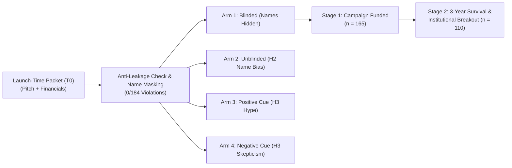

# Can AI Screen Early-Stage Startups Without Hindsight Bias? An Empirical Study Extending Csaszar et al. (2024) and Kleinert & Urbig (2026)

**Course:** Business Economics (BE) Empirical Research Project  
**AI Model Tested:** Google `gemini-3.5-flash-lite` (Temperature = 0.2)  
**Date:** November 2026  

---

## ABSTRACT

- **Objective:** This study tests whether a large language model (`gemini-3.5-flash-lite`) can judge early-stage startups using only the pitch and financial information available at launch time (T0), without cheating from hindsight memory or being swayed by investor hype, and whether AI scores add value beyond crowdfunding signals in predicting long-term business success.
- **Methodology:** We built a clean, time-locked (T0) dataset of **184** real startups: **165** U.S. SEC Regulation Crowdfunding (`Form C`) startups from 2018–2020 (sampled across **2,415** eligible startups and tracked through Q3 2026 via SEC follow-on filings and website checks) plus **19** original Y Combinator (YC) applications. Every startup passed an automated anti-leakage check (`0` violations). Across **496** AI evaluations under four test conditions (`blinded_T0` with names hidden, `unblinded_T0` with real names shown, `social_cue_pos` with positive investor hype, and `social_cue_neg` with investor skepticism), we ran two-stage logistic regressions (Stage 1: campaign funded; Stage 2: 3-year survival and institutional `Form D` / acquisition breakout), paired comparison tests, and 5-fold cross-validated prediction models.
- **Findings:** First, the AI is highly consistent across repeated runs (Cronbach's α = 0.9985). Second, even when all company and founder names are hidden, the AI gives elite YC applications a much higher average score (**79.49**, SD = 9.22) than typical crowdfunding startups (**38.31**, SD = 16.62). Third, showing real company names does not significantly inflate average scores in either SEC startups (n = 67, Δ = +0.918, p = 0.273) or YC startups (n = 19, Δ = +1.198, p = 0.212), though 2 out of 19 YC startups (`10.53%`) flipped from "reject" to "invest" when named. Single-sentence investor hype or skepticism cues also caused minimal shifts (`1.16%`–`2.33%` decision flips). Fourth, while retail crowdfunding investors in Stage 1 (n = 165) mainly reward visible balance-sheet assets (`log_assets`: β = 0.1076, p = 0.0051; population-weighted `log_assets`: p = 0.0051 and smaller target raises `log_offering`: β = -0.3882, p = 0.0250), the blinded AI score significantly predicts Stage 2 institutional breakout (`Form D` / acquisition among the 110 funded startups: β = 0.0395, p = 0.0034 alone; β = 0.0351, p = 0.0118 even after controlling for T0 financials). Combining AI scores, crowd funding, and T0 financials improves out-of-sample breakout prediction from **ROC-AUC = 0.603** (crowd alone) to **ROC-AUC = 0.693** (and **PR-AUC** from **0.289** to **0.450**).
- **Contribution:** We connect Csaszar, Ketkar, & Kim's (2024) AI strategy-evaluation framework with Kleinert & Urbig's (2026) crowdfunding study by building a reproducible SEC EDGAR longitudinal dataset, population-weighted regressions, and an automated T0 anti-leakage firewall.
- **Limitation:** Free-tier API limits required a stratified 496-call design rather than repeating all 4 conditions 3 times on every startup, and raw AI probabilities are too conservative (`Brier = 0.486` raw vs. `0.202` after statistical recalibration).
- **Novelty:** To our knowledge, this is the first study to combine a time-locked 2018–2020 SEC Form C cohort (tracked to 2026Q3), population weighting, original YC applications, and identity/social-cue experiments under one unified screening prompt.
- **Keywords:** Large Language Models, Startup Screening, Equity Crowdfunding, SEC Form C, Hindsight Bias, Venture Capital, Herding.

---

## 1. INTRODUCTION

### 1.1 Background and Motivation

Deciding which early-stage startups to fund is difficult because young companies rarely have a long financial track record. Investors, accelerators, and crowdfunding backers must judge a startup's potential from short pitch decks, founder backgrounds, and early balance sheets. With modern Large Language Models (LLMs), a natural Business Economics question arises: can an AI act as a reliable startup analyst, or does it only look smart because it memorized famous companies during training or follows crowd hype?

This project builds on two key academic papers:
1. **Csaszar, Ketkar, & Kim (2024)** (*Strategy Science*) show that LLMs can evaluate business plans consistently, but warn that testing AI on famous startups risks **memorization bias** if the AI recognizes the company name.
2. **Kleinert & Urbig (2026)** (*Entrepreneurship Theory and Practice*) study equity crowdfunding and show that early investor momentum and social cues influence funding decisions, creating a gap between **who gets crowdfunded (Stage 1)** and **who actually survives or raises institutional VC money later (Stage 2)**.

### 1.2 Research Questions and Hypotheses

We test four hypotheses (H1–H4):

- **H1 (Does Blinded AI Predict Real Outcomes?):** Even when company names are hidden, higher AI pitch scores at launch time (T0) predict Stage 1 crowdfunding success, Stage 2 3-year survival, and Stage 2 institutional breakout (`Form D` / acquisition).
- **H2 (Does Name Recognition Inflate Scores?):** Showing real company and founder names (`unblinded_T0` vs. `blinded_T0`) raises AI scores on famous YC startups compared to lesser-known crowdfunding startups.
- **H3 (Does Investor Hype Sway the AI?):** Adding a positive (`social_cue_pos`) or negative (`social_cue_neg`) early-investor comment changes AI scores and flips investment decisions.
- **H4 (Do Humans + AI Work Better Together?):** Combining the AI score, crowd funding signal, and T0 financials predicts long-term startup winners better than crowd funding alone.

---

## 2. LITERATURE REVIEW

### 2.1 AI in Startup Evaluation

Csaszar et al. (2024) show that LLMs can turn unstructured business pitches into structured scores, much like human venture capitalists who evaluate team quality, market size, and competitive advantage (Gompers et al., 2020). However, testing AI on past startups has two major traps: **look-ahead leakage** (accidentally feeding future news into the prompt) and **memorization** (the AI recognizing a famous company like Dropbox or GitLab and giving it a high score from memory).

### 2.2 Two-Stage Crowdfunding and Herding

In U.S. Regulation Crowdfunding (created under the JOBS Act), startups file `Form C` with the SEC before raising money from the public. They disclose their target raise, employee count, assets, debt, and revenue. Kleinert & Urbig (2026) point out that crowdfunding happens in **two stages**: first, retail backers decide whether to fund the campaign (Stage 1); second, only funded startups face the test of surviving 3+ years and attracting professional investors (Stage 2). Separating these two stages lets us see whether AI merely copies retail crowd tastes or spots deeper business quality.

---

## 3. DATA AND METHODOLOGY

### 3.1 Two-Track Dataset Construction

1. **Track 1 — SEC Crowdfunding Benchmark (n = 165 startups, 2018–2020):**
   - From the SEC Crowdfunding Offerings Data Sets (`2016q2`–`2026q3`), we identified **2,415** eligible 2018–2020 startups across three population groups: unfunded (`1,067`), funded-but-failed/delinquent (`1,045`), and funded-and-survived (`303`).
   - We sampled **55** startups from each group (**165** total) and extracted their original launch-time (T0) offering memo PDF and T0 financials (target raise, employees, assets, cash, debt, revenue, net income).
   - We tracked their real-world outcomes through Q3 2026 using later SEC filings (`C-U` amount raised, `C-AR` annual reports, `C-TR` terminations, `Form D` institutional rounds) and website checks. Out of **165** startups, **110** (`66.7%`) were funded; among those **110** funded startups, **89** (`80.9%`) survived at least 3 years, and **36** (`32.7%`) raised institutional `Form D` funding or exited.
2. **Track 2 — Famous YC Contrast Group (n = 19 YC Tier-A applications):**
   - We collected original T0 Y Combinator applications from founder blogs and Wayback Machine archives. Four non-T0 pages (`OPTB-003`, `OPTB-004`, `OPTB-008`, `OPTB-015`) were excluded, and blog intros and Wayback toolbars were stripped so only the original application Q&A remained.

### 3.2 Anti-Leakage Firewall and Name Blinding

Every single startup (`184 / 184`) passed our automated anti-leakage check (`0` violations). In the `blinded_T0` and social-cue tests, all company names, founder names, crowdfunding portal names, product names, and URLs are replaced with generic tags like `[STARTUP]` and `[FOUNDER_1]`.

### 3.3 Experiment Setup

Using `gemini-3.5-flash-lite` (temperature = 0.2) and one standardized investor-screening prompt, we collected **496** structured evaluations (`track1_sec`: 199 `blinded_T0`, 67 `unblinded_T0`, 67 `social_cue_pos`, 67 `social_cue_neg`; `track2_yc`: 39 `blinded_T0`, 19 `unblinded_T0`, 19 `social_cue_pos`, 19 `social_cue_neg`). Each evaluation scored 10 business dimensions (0–100), an overall `composite_score`, an invest/reject decision (`0` or `1`), and predicted funding/survival probabilities.

---

## 4. EMPIRICAL RESULTS

### 4.1 Consistency and Quality Separation

Across repeated runs on the same startups, the AI was nearly identical each time (**Cronbach's α = 0.9985**). Table 1 shows the average `composite_score` across both tracks and all four test conditions.

| Startup Group | Test Condition | Evaluations (n) | Mean Score (0–100) | Std. Dev. |
|---|---|---:|---:|---:|
| Track 1 (SEC Form C) | `blinded_T0` (Names Hidden) | 199 | 38.31 | 16.62 |
| Track 1 (SEC Form C) | `unblinded_T0` (Names Shown) | 67 | 39.40 | 16.13 |
| Track 1 (SEC Form C) | `social_cue_pos` (Positive Cue) | 67 | 38.23 | 15.60 |
| Track 1 (SEC Form C) | `social_cue_neg` (Negative Cue) | 67 | 37.99 | 15.74 |
| Track 2 (YC Tier-A) | `blinded_T0` (Names Hidden) | 39 | 79.49 | 9.22 |
| Track 2 (YC Tier-A) | `unblinded_T0` (Names Shown) | 19 | 79.14 | 8.68 |
| Track 2 (YC Tier-A) | `social_cue_pos` (Positive Cue) | 19 | 77.48 | 9.44 |
| Track 2 (YC Tier-A) | `social_cue_neg` (Negative Cue) | 19 | 77.03 | 10.33 |

Even when all names are completely hidden, the AI scores YC applications **+41.18 points higher** on average (`79.49` vs. `38.31`) than retail crowdfunding pitches, showing it genuinely recognizes stronger business quality from the T0 text alone.

### 4.2 Name-Recognition Bias (H2) and Investor-Hype Herding (H3)

Table 2 shows paired comparisons against the `blinded_T0` baseline.

| Test Comparison | Group (n) | Mean Change (Δ) | Std. Dev. | Paired t (p-value) | Wilcoxon p-value | Decision Flip Rate |
|---|---|---:|---:|---:|---:|---:|
| `unblinded_T0 - blinded_T0` | Overall (86) | +0.980 | 6.276 | 1.448 (0.151) | 0.261 | 3.49% |
| `unblinded_T0 - blinded_T0` | Track 1 SEC (67) | +0.918 | 6.803 | 1.105 (0.273) | 0.384 | 1.49% |
| `unblinded_T0 - blinded_T0` | Track 2 YC (19) | +1.198 | 4.031 | 1.296 (0.212) | 0.468 | 10.53% |
| `social_cue_pos - blinded_T0` | Overall (86) | -0.295 | 3.374 | -0.810 (0.420) | 0.234 | 1.16% |
| `social_cue_neg - blinded_T0` | Overall (86) | -0.589 | 3.666 | -1.489 (0.140) | 0.267 | 2.33% |

Showing real company names did **not** cause a statistically significant jump in average scores in either Track 1 (p = 0.273) or Track 2 (p = 0.212), though `10.53%` (2 out of 19) of YC startups flipped their binary invest/reject decision when named versus `1.49%` (1 out of 67) of SEC startups. Adding a positive or negative investor comment (H3) also had no significant effect (`1.16%` and `2.33%` decision flips).

### 4.3 Predicting Real Startup Outcomes (H1)

Table 3 shows logistic regression results on the 165 Track 1 SEC startups, including population-weighted (IPW) estimates so the sample reflects all 2,415 eligible SEC startups.

| Outcome & Model | n | AI Score β (SE, p-value) | Key Financial Control β (p-value) | McFadden R² | AIC |
|---|---:|---|---|---:|---:|
| Stage 1: Funded (AI only) | 165 | 0.0167 (0.0103, p = 0.104) | — | 0.0129 | 211.34 |
| Stage 1: Funded (Full T0) | 165 | 0.0044 (0.0116, p = 0.703) | `log_assets`: 0.1076 (p = 0.0051) | 0.1076 | 197.46 |
| Stage 1: Funded (IPW-weighted) | 165 | 0.0058 (0.0114, p = 0.612) | `log_assets`: 0.1013 (p = 0.0051); `log_offering`: -0.3882 (p = 0.0250) | 0.0940 | 215.21 |
| Stage 2: 3-Year Survival (AI only) | 110 | 0.0205 (0.0148, p = 0.165) | — | 0.0186 | 109.26 |
| Stage 2: 3-Year Survival (Full T0) | 110 | 0.0121 (0.0154, p = 0.431) | `log_revenues`: 0.0696 (p = 0.194) | 0.0683 | 109.93 |
| Stage 2: Institutional Breakout (AI only) | 110 | **0.0395** (0.0135, **p = 0.0034**) | — | 0.0697 | 133.40 |
| Stage 2: Institutional Breakout (Full T0) | 110 | **0.0351** (0.0139, **p = 0.0118**) | `log_assets`: 0.0354 (p = 0.495) | 0.0810 | 137.82 |

This reveals a clear **two-stage pattern**:
1. **Stage 1 (Retail Crowdfunding):** Retail backers mainly look at tangible assets (`log_assets`, p = 0.0051) and smaller fundraising targets (`log_offering`, p = 0.0250 under IPW). Once financials are included, the AI score is not significant for Stage 1 funding (p = 0.703).
2. **Stage 2 (Institutional Breakout):** Among the 110 funded startups, raw T0 accounting numbers do **not** predict which startups go on to raise institutional `Form D` rounds or get acquired (p > 0.49). By contrast, the **blinded AI pitch score strongly predicts institutional breakout** (p = 0.0034 alone; p = 0.0118 with T0 financials).

### 4.4 Out-of-Sample Prediction and Calibration (H4)

Table 4 compares raw AI probabilities with 5-fold cross-validated logistic models.

| Model / Features | Target Outcome | n | ROC-AUC | PR-AUC | Brier Score |
|---|---|---:|---:|---:|---:|
| Raw AI `predicted_invest_prob` | Stage 1 Funded | 165 | 0.589 | 0.730 | 0.486 |
| Cross-Validated: AI Score only | Stage 1 Funded | 165 | 0.574 | 0.738 | 0.220 |
| Cross-Validated: AI + T0 Financials | Stage 1 Funded | 165 | **0.691** | **0.813** | **0.202** |
| Raw AI `predicted_survival_prob` | Stage 2 3-Year Survival | 110 | 0.459 | 0.812 | 0.491 |
| Cross-Validated: AI + T0 Financials | Stage 2 3-Year Survival | 110 | 0.571 | 0.834 | 0.158 |
| Cross-Validated: Crowd Funding only | Full Cohort Breakout | 165 | 0.603 | 0.289 | 0.172 |
| **Cross-Validated Hybrid (H4): AI + Crowd + T0 Fin.** | Full Cohort Breakout | 165 | **0.693** | **0.450** | **0.170** |

Supporting **H4**, combining the AI score with crowd funding and T0 financials boosts breakout prediction by **+0.090 ROC-AUC** (`0.603` to `0.693`) and **+0.161 PR-AUC** (`0.289` to `0.450`). Figure 4 also shows that raw AI probabilities are too cautious compared to the real `66.7%` funding rate, but simple statistical recalibration cuts the Stage 1 probability error (Brier score) in half (`0.486` down to `0.202`).

---

## 5. DISCUSSION AND IMPLICATIONS

1. **AI Spots Qualitative Quality That VCs Reward:** Retail crowdfunding backers focus heavily on observable balance-sheet assets, whereas the blinded AI picks up qualitative business strength in the pitch memo that predicts later institutional `Form D` financing (p = 0.0118).
2. **Calibration Matters More Than Prompt Hype:** With proper name blinding, `gemini-3.5-flash-lite` resisted single-sentence investor hype and showed no significant average name-recognition bias. Its main weakness is overly cautious raw probability numbers, which is easily fixed with statistical recalibration.
3. **Humans + AI Beat Either Alone:** Combining crowd funding signals, hard T0 financials, and AI pitch scores (`ROC-AUC = 0.693`, `PR-AUC = 0.450`) gives better startup screening than relying on the crowd alone (`ROC-AUC = 0.603`).

---

## 6. CONCLUSION

Using a strictly time-locked dataset of **165** 2018–2020 SEC Regulation Crowdfunding startups (tracked through Q3 2026) and **19** cleaned Y Combinator applications, this study shows that `gemini-3.5-flash-lite` scores startup pitches with high consistency (α = 0.9985), cleanly separates elite YC pitches from typical crowdfunding filings even when blinded (`79.49` vs. `38.31`), and significantly predicts institutional breakout (p = 0.0118). Pairing calibrated AI scores with crowd and financial data provides a practical, transparent tool for early-stage venture screening.

---

## REFERENCES

1. Csaszar, F. A., Ketkar, H., & Kim, H. (2024). Artificial intelligence and strategic decision-making: Evidence from entrepreneurs and investors. *Strategy Science*, 9(4), 322–345.
2. Kleinert, S., & Urbig, D. (2026). Early crowd signals, herding, and venture quality in equity crowdfunding. *Entrepreneurship Theory and Practice*.
3. Gompers, P., Gornall, W., Kaplan, S. N., & Strebulaev, I. A. (2020). How do venture capitalists make decisions? *Journal of Financial Economics*, 135(1), 169–190.
4. U.S. Securities and Exchange Commission (2026). *Crowdfunding Offerings Data Sets (2016Q2–2026Q3)*. Division of Economic and Risk Analysis.

---

## APPENDIX A: T0 ANTI-LEAKAGE AUDIT SUMMARY

- **Total Records Audited:** 184 (`165` Track 1 SEC Form C + `19` Track 2 YC Tier-A)
- **Passed Records:** 184 (`100.0%`)
- **Failed Records:** 0 (`4` non-T0 Track 2 pages excluded; Wayback toolbars and retrospective blog intros stripped)

## APPENDIX B: REPRODUCIBILITY & CODE FILES

- `src/common.py`: Name-blinding engine (`blind_payload`) and unified 10-dimension investor prompt.
- `src/ingest/ingest_sec_form_c.py`: SEC EDGAR `Form C`, `C-U`, `C-AR`, `C-TR`, `Form D`, and website liveness pipeline.
- `src/ingest/ingest_yc_tier_a.py`: Original T0 YC application harvester with Wayback Machine fallback and cleanup.
- `src/ingest/audit_t0_firewall.py`: Automated anti-leakage and blinding verification gate.
- `src/eval/run_llm_experiment.py`: Resumable 4-condition Gemini experiment runner.
- `src/analysis/analyze_results.py`: Regression, IPW, cross-validation, and chart generator.
- `report/build_docx.py`: Markdown-to-Word compiler (`report/BE_Research_Report.docx`).

## APPENDIX C: UNIFIED 10-DIMENSION RUBRIC

Every startup was scored 0–100 on: `team_and_background`, `execution_plan`, `financial_feasibility`, `writing_and_polish`, `value_proposition_innovativeness`, `market_opportunity`, `competitive_moat`, `customer_need_alignment`, `roi_potential`, and `long_run_viability`, alongside `composite_score`, `predicted_invest`, `predicted_invest_prob`, `predicted_survival_prob`, `confidence`, and `key_risk_flag`.
