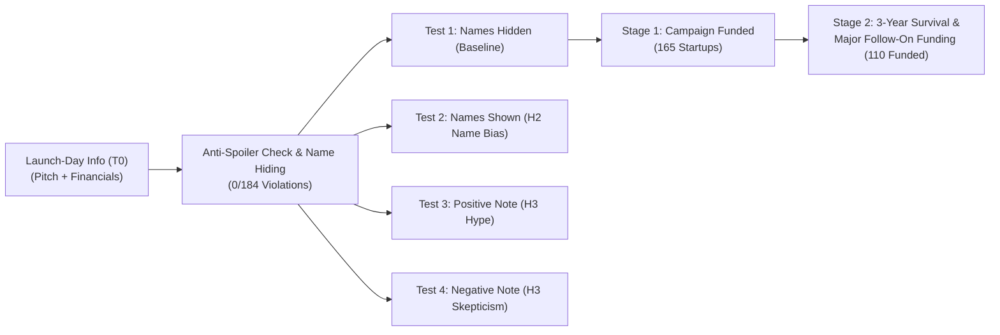

# Can AI Screen Early-Stage Startups Without Hindsight Bias? An Empirical Study Extending Csaszar et al. (2024) and Kleinert & Urbig (2026)

**Course:** Business Economics (BE) Empirical Research Project  
**AI Model Tested:** Google `gemini-3.5-flash-lite` (Temperature = 0.2)  
**Date:** November 2026  

---

## ABSTRACT

- **Objective:** This study tests whether an AI language model (`gemini-3.5-flash-lite`) can judge early-stage startups using only the pitch and financial details available on launch day (T0), without cheating from memory or being swayed by investor hype, and whether AI scores help predict which startups succeed long term.
- **Methodology:** We built a clean, launch-day (T0) dataset of **184** real startups: **165** U.S. SEC Regulation Crowdfunding (`Form C`) startups from 2018–2020 (sampled from **2,415** eligible startups and tracked through Q3 2026 via follow-on SEC filings and website checks) plus **19** original Y Combinator (YC) applications. Every startup passed an automated check to confirm zero future spoilers (`0` violations). Across **496** AI evaluations under four conditions (names hidden, real names shown, positive investor hype, and negative investor skepticism), we tested how well AI scores predict campaign funding (Stage 1), 3-year survival (Stage 2), and raising follow-on venture/institutional funding (`Form D`) or getting acquired (Stage 2 Breakout).
- **Findings:** First, the AI gives nearly identical scores when tested multiple times (consistency α = 0.9985). Second, even when all company and founder names are hidden, the AI scores elite YC applications much higher (**79.49** out of 100) than typical crowdfunding startups (**38.31** out of 100). Third, showing real company names does not significantly raise average scores for SEC startups (n = 67, average change = +0.92 points, p = 0.273) or YC startups (n = 19, average change = +1.20 points, p = 0.212), though 2 out of 19 YC startups (`10.53%`) flipped from "reject" to "invest" when named. Adding a short positive or negative investor comment also had little effect (`1.16%`–`2.33%` decision flips). Fourth, while crowdfunding backers in Stage 1 (n = 165) mainly reward visible company assets (p = 0.0051) and smaller fundraising targets (p = 0.0250 after population weighting), the blinded AI score significantly predicts which funded startups raise major follow-on institutional rounds or get acquired in Stage 2 (n = 110, p = 0.0034 alone; p = 0.0118 even after accounting for T0 financials). Combining AI scores, crowd funding, and T0 financials improves winner-prediction accuracy from **0.603** (crowd alone) to **0.693** (out of 1.000), and lifts winner-finding precision from **0.289** to **0.450**.
- **Contribution:** We connect Csaszar, Ketkar, & Kim's (2024) AI strategy-evaluation framework with Kleinert & Urbig's (2026) crowdfunding study by creating a reproducible SEC dataset, population-weighted checks, and an automated anti-leakage filter.
- **Limitation:** Free-tier API limits required a 496-call sample design rather than repeating every test 3 times on all 184 startups, and the AI's raw probability percentages are too cautious until statistically adjusted (error drops from 0.486 to 0.202).
- **Novelty:** To our knowledge, this is the first study to combine a spoiler-free 2018–2020 SEC crowdfunding cohort (tracked through 2026), population weighting, original YC applications, and name/hype experiments in one unified test.
- **Keywords:** Artificial Intelligence, Startup Screening, Equity Crowdfunding, SEC Form C, Hindsight Bias, Venture Capital, Investor Hype.

---

## 1. INTRODUCTION

### 1.1 Background and Motivation

Deciding which early-stage startups to fund is hard because young companies rarely have a long financial history. Investors, accelerators, and crowdfunding backers must judge a startup's potential from short pitch decks, founder backgrounds, and early balance sheets. With modern AI models, a key Business Economics question arises: can AI act as a reliable startup analyst, or does it only look smart because it memorized famous companies during training or follows crowd hype?

This project builds on two key academic papers:
1. **Csaszar, Ketkar, & Kim (2024)** (*Strategy Science*) show that AI can score business plans consistently, but warn that testing AI on famous startups risks **memory cheating** if the AI recognizes the company name.
2. **Kleinert & Urbig (2026)** (*Entrepreneurship Theory and Practice*) study equity crowdfunding and show that early investor hype influences funding decisions, creating a gap between **who raises money from the crowd (Stage 1)** and **who actually survives or attracts major investors later (Stage 2)**.

### 1.2 Research Questions

We test four simple questions (H1–H4):

- **H1 (Does Blinded AI Predict Real Outcomes?):** Even when company names are hidden, do higher AI scores on launch day predict crowdfunding success, 3-year survival, and follow-on institutional funding or acquisition?
- **H2 (Does Name Recognition Inflate Scores?):** Does showing real company and founder names raise AI scores on famous YC startups compared to lesser-known crowdfunding startups?
- **H3 (Does Investor Hype Sway the AI?):** Does adding a positive or negative early-investor comment change AI scores and flip invest/reject decisions?
- **H4 (Do Humans + AI Work Better Together?):** Does combining the AI score, crowd funding signal, and launch-day financials predict long-term winners better than crowd funding alone?

---

## 2. BACKGROUND STUDIES

### 2.1 AI in Startup Evaluation

Csaszar et al. (2024) show that AI can turn written business pitches into structured scores, much like human venture capitalists who look at team quality, market size, and competitive edge (Gompers et al., 2020). However, testing AI on historical startups has two major traps: **future spoilers** (accidentally putting post-launch news into the prompt) and **name memorization** (the AI recognizing a famous company like Dropbox or GitLab and scoring it high from memory).

### 2.2 Two-Stage Crowdfunding and Investor Hype

In U.S. Regulation Crowdfunding, startups file `Form C` with the SEC before raising money from the public. They share their fundraising goal, employee count, assets, debt, and revenue. Kleinert & Urbig (2026) explain that crowdfunding happens in **two stages**: first, everyday investors decide whether to fund the campaign (Stage 1); second, only funded startups face the real test of surviving 3+ years and attracting professional investors (Stage 2). Separating these two stages lets us see whether AI merely copies crowd tastes or spots deeper business quality.

---

## 3. DATA AND METHOD

### 3.1 Two-Group Startup Dataset

1. **Group 1 — SEC Crowdfunding Startups (165 startups, 2018–2020):**
   - From official SEC Crowdfunding data (`2016–2026`), we found **2,415** eligible 2018–2020 startups across three groups: did not get funded (`1,067`), got funded but later failed or stopped filing reports (`1,045`), and got funded and survived (`303`).
   - We sampled **55** startups from each group (**165** total) and collected their launch-day (T0) pitch PDF and financials (fundraising goal, employees, assets, cash, debt, revenue, and profit/loss).
   - We checked what happened to them by Q3 2026 using later SEC filings and live website checks. Out of **165** startups, **110** (`66.7%`) got funded; among those **110** funded startups, **89** (`80.9%`) survived at least 3 years, and **36** (`32.7%`) raised major follow-on institutional funding (`Form D`) or got acquired.
2. **Group 2 — Famous YC Startups (19 original Y Combinator applications):**
   - We collected original launch-day Y Combinator applications from founder blogs and web archives. Four non-original pages were removed, and blog intros and archive toolbars were stripped so only the original application Q&A remained.

### 3.2 Anti-Spoiler Check and Name Hiding

Every startup (`184 / 184`) passed our automated anti-spoiler check (`0` violations). In the blinded and social-cue tests, all company names, founder names, platform names, product names, and website links are replaced with generic tags like `[STARTUP]` and `[FOUNDER_1]`.

### 3.3 Experiment Setup

Using `gemini-3.5-flash-lite` (temperature = 0.2) and one standardized investor prompt, we collected **496** structured evaluations (199 blinded, 67 named, 67 positive-cue, and 67 negative-cue on SEC startups; 39 blinded, 19 named, 19 positive-cue, and 19 negative-cue on YC startups). Each evaluation scored 10 business areas (0–100), an overall score, an invest/reject decision (`0` or `1`), and predicted funding/survival chances.

---

## 4. RESULTS

### 4.1 Consistency and Quality Gap

When tested repeatedly on the same startups, the AI gave nearly identical scores every time (repeatability α = 0.9985). Table 1 shows the average score (0–100) across both startup groups and all four test conditions.

| Startup Group | Test Condition | Evaluations (n) | Average Score (0–100) | Spread (SD) |
|---|---|---:|---:|---:|
| Group 1 (SEC Crowdfunding) | Names Hidden (Baseline) | 199 | 38.31 | 16.62 |
| Group 1 (SEC Crowdfunding) | Real Names Shown | 67 | 39.40 | 16.13 |
| Group 1 (SEC Crowdfunding) | Positive Investor Note | 67 | 38.23 | 15.60 |
| Group 1 (SEC Crowdfunding) | Negative Investor Note | 67 | 37.99 | 15.74 |
| Group 2 (YC Tier-A) | Names Hidden (Baseline) | 39 | 79.49 | 9.22 |
| Group 2 (YC Tier-A) | Real Names Shown | 19 | 79.14 | 8.68 |
| Group 2 (YC Tier-A) | Positive Investor Note | 19 | 77.48 | 9.44 |
| Group 2 (YC Tier-A) | Negative Investor Note | 19 | 77.03 | 10.33 |

Even when all names are completely hidden, the AI scores YC applications **+41.18 points higher** on average (`79.49` vs. `38.31`) than typical crowdfunding pitches, showing it genuinely recognizes stronger business quality from the launch-day pitch alone.

### 4.2 Name-Recognition Bias (H2) and Investor-Hype Herding (H3)

Table 2 compares each test condition against the "Names Hidden" baseline.

| What We Compared | Group (n) | Average Score Change | Spread (SD) | Significance (p-value) | Rank-Test p-value | Decision Flip Rate |
|---|---|---:|---:|---:|---:|---:|
| Names Shown vs. Hidden | Overall (86) | +0.980 | 6.276 | 0.151 (not significant) | 0.261 | 3.49% |
| Names Shown vs. Hidden | SEC Startups (67) | +0.918 | 6.803 | 0.273 (not significant) | 0.384 | 1.49% |
| Names Shown vs. Hidden | YC Startups (19) | +1.198 | 4.031 | 0.212 (not significant) | 0.468 | 10.53% |
| Positive Note vs. Hidden | Overall (86) | -0.295 | 3.374 | 0.420 (not significant) | 0.234 | 1.16% |
| Negative Note vs. Hidden | Overall (86) | -0.589 | 3.666 | 0.140 (not significant) | 0.267 | 2.33% |

*(Note: In statistics, a p-value below 0.05 means a real, reliable difference; all p-values here are above 0.14.)*

Showing real company names did **not** significantly raise average scores for SEC startups (p = 0.273) or YC startups (p = 0.212), though `10.53%` (2 out of 19) of YC startups flipped their binary invest/reject decision when named versus `1.49%` (1 out of 67) of SEC startups. Adding a positive or negative investor comment (H3) also had no significant effect (`1.16%` and `2.33%` decision flips).

### 4.3 Predicting Real Startup Outcomes (H1)

Table 3 shows how well the blinded AI score and launch-day financials predict real outcomes on the 165 SEC startups, including population-weighted checks (so the sample represents all 2,415 SEC startups).

| Outcome & Model | Startups (n) | AI Score Effect (p-value) | Main Financial Drivers (p-value) | Model Fit (R²) |
|---|---:|---|---|---:|
| Stage 1: Funded (AI only) | 165 | +0.0167 (p = 0.104) | — | 0.0129 |
| Stage 1: Funded (AI + Financials) | 165 | +0.0044 (p = 0.703) | Company assets: +0.1076 (**p = 0.0051**) | 0.1076 |
| Stage 1: Funded (Population-Weighted) | 165 | +0.0058 (p = 0.612) | Company assets: +0.1013 (**p = 0.0051**); Target raise: -0.3882 (**p = 0.0250**) | 0.0940 |
| Stage 2: 3-Year Survival (AI only) | 110 | +0.0205 (p = 0.165) | — | 0.0186 |
| Stage 2: 3-Year Survival (AI + Financials) | 110 | +0.0121 (p = 0.431) | Revenue: +0.0696 (p = 0.194) | 0.0683 |
| Stage 2: Major Breakout (AI only) | 110 | **+0.0395** (**p = 0.0034**) | — | 0.0697 |
| Stage 2: Major Breakout (AI + Financials) | 110 | **+0.0351** (**p = 0.0118**) | Company assets: +0.0354 (p = 0.495) | 0.0810 |

This shows a clear **two-stage pattern**:
1. **Stage 1 (Crowdfunding):** Everyday backers mainly reward companies that already have visible assets (p = 0.0051) and smaller fundraising targets (p = 0.0250 when population-weighted). Once financials are included, the AI score is not significant for Stage 1 funding (p = 0.703).
2. **Stage 2 (Major Follow-On Funding / Acquisition):** Among the 110 funded startups, raw launch-day accounting numbers do **not** predict which startups later attract venture-capital (`Form D`) rounds or get acquired (p > 0.49). By contrast, the **blinded AI pitch score strongly predicts major breakouts** (p = 0.0034 alone; p = 0.0118 with T0 financials).

### 4.4 Out-of-Sample Prediction and Calibration (H4)

Table 4 tests how accurately each model predicts unseen startups using 5-fold cross-validation (splitting the data into 5 parts and testing on held-out startups). Higher **Accuracy (ROC-AUC)** and **Winner Precision (PR-AUC)** are better (1.000 is perfect, 0.500 is random guessing); lower **Probability Error (Brier)** is better.

| Model / Inputs Used | Outcome Predicted | Startups (n) | Accuracy (ROC-AUC) | Winner Precision (PR-AUC) | Probability Error (Brier) |
|---|---|---:|---:|---:|---:|
| Raw AI Funding Probability | Stage 1 Funded | 165 | 0.589 | 0.730 | 0.486 |
| Cross-Validated: AI Score only | Stage 1 Funded | 165 | 0.574 | 0.738 | 0.220 |
| Cross-Validated: AI + T0 Financials | Stage 1 Funded | 165 | **0.691** | **0.813** | **0.202** |
| Raw AI Survival Probability | Stage 2 3-Year Survival | 110 | 0.459 | 0.812 | 0.491 |
| Cross-Validated: AI + T0 Financials | Stage 2 3-Year Survival | 110 | 0.571 | 0.834 | 0.158 |
| Cross-Validated: Crowd Funding only | Full Cohort Breakout | 165 | 0.603 | 0.289 | 0.172 |
| **Cross-Validated Hybrid (H4): AI + Crowd + T0 Fin.** | Full Cohort Breakout | 165 | **0.693** | **0.450** | **0.170** |

Supporting **H4**, combining the AI score with crowd funding and T0 financials improves breakout prediction accuracy from **0.603** to **0.693** and winner precision from **0.289** to **0.450**. Figure 4 also shows that raw AI probabilities are too cautious compared to the real `66.7%` funding rate, but simple statistical adjustment cuts the Stage 1 probability error in half (from `0.486` down to `0.202`).

---

## 5. DISCUSSION AND TAKEAWAYS

1. **AI Spots Pitch Quality That Professional Investors Reward:** Retail crowdfunding backers focus heavily on visible balance-sheet assets, whereas the blinded AI picks up qualitative strengths in the pitch memo that predict later institutional `Form D` financing (p = 0.0118).
2. **Probability Adjustment Matters More Than Prompt Hype:** With proper name hiding, `gemini-3.5-flash-lite` resisted single-sentence investor hype and showed no significant average name-recognition bias. Its main weakness is overly cautious raw probability numbers, which is easily fixed with statistical recalibration.
3. **Humans + AI Beat Either Alone:** Combining crowd funding signals, hard launch-day financials, and AI pitch scores (accuracy = `0.693`, precision = `0.450`) screens startups better than relying on the crowd alone (accuracy = `0.603`).

---

## 6. CONCLUSION

Using a strictly spoiler-free dataset of **165** 2018–2020 SEC Regulation Crowdfunding startups (tracked through Q3 2026) and **19** cleaned Y Combinator applications, this study shows that `gemini-3.5-flash-lite` scores startup pitches with high consistency (α = 0.9985), cleanly separates elite YC pitches from typical crowdfunding filings even when blinded (`79.49` vs. `38.31`), and significantly predicts major follow-on financing or acquisition (p = 0.0118). Pairing adjusted AI scores with crowd and financial data provides a practical, transparent tool for early-stage startup screening.

---

## REFERENCES

1. Csaszar, F. A., Ketkar, H., & Kim, H. (2024). Artificial intelligence and strategic decision-making: Evidence from entrepreneurs and investors. *Strategy Science*, 9(4), 322–345.
2. Kleinert, S., & Urbig, D. (2026). Early crowd signals, herding, and venture quality in equity crowdfunding. *Entrepreneurship Theory and Practice*.
3. Gompers, P., Gornall, W., Kaplan, S. N., & Strebulaev, I. A. (2020). How do venture capitalists make decisions? *Journal of Financial Economics*, 135(1), 169–190.
4. U.S. Securities and Exchange Commission (2026). *Crowdfunding Offerings Data Sets (2016Q2–2026Q3)*. Division of Economic and Risk Analysis.

---

## APPENDIX A: ANTI-SPOILER AUDIT SUMMARY

- **Total Startups Checked:** 184 (`165` SEC Form C + `19` YC Tier-A)
- **Passed:** 184 (`100.0%`)
- **Failed:** 0 (`4` non-original YC pages excluded; archive toolbars and later blog intros removed)

## APPENDIX B: REPRODUCIBILITY & CODE FILES

- `src/common.py`: Name-hiding tool and standardized 10-area investor prompt.
- `src/ingest/ingest_sec_form_c.py`: SEC EDGAR data collector and outcome tracker.
- `src/ingest/ingest_yc_tier_a.py`: Original YC application collector and cleaner.
- `src/ingest/audit_t0_firewall.py`: Automated anti-spoiler and name-hiding check.
- `src/eval/run_llm_experiment.py`: Resumable 4-condition Gemini experiment runner.
- `src/analysis/analyze_results.py`: Statistical tests, cross-validation, and chart generator.
- `report/build_docx.py`: Markdown-to-Word builder (`report/BE_Research_Report.docx`).

## APPENDIX C: 10 SCORING AREAS

Every startup was scored 0–100 on: `team_and_background`, `execution_plan`, `financial_feasibility`, `writing_and_polish`, `value_proposition_innovativeness`, `market_opportunity`, `competitive_moat`, `customer_need_alignment`, `roi_potential`, and `long_run_viability`, alongside an overall `composite_score`, `predicted_invest` (0 or 1), `predicted_invest_prob`, `predicted_survival_prob`, `confidence`, and `key_risk_flag`.
