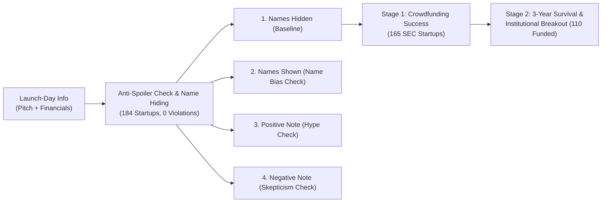
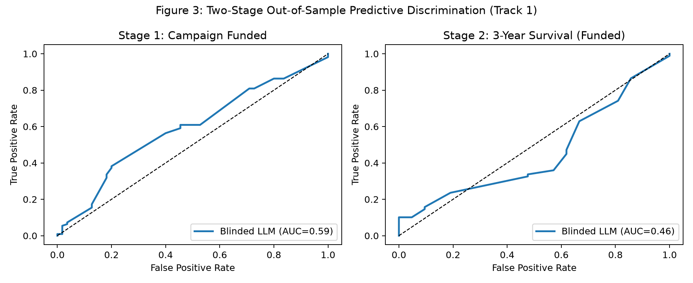

# Can AI Screen Early-Stage Startups Without Hindsight Bias? An Empirical Study Extending Csaszar et al. (2024) and Kleinert & Urbig (2026)

**Course:** Business Economics (BE) Empirical Research Project  
**AI Model Tested:** Google `gemini-3.5-flash-lite`  
**Date:** November 2026  

---

## ABSTRACT

- **Objective:** This study asks a practical question: can an AI model judge early-stage startups fairly using only the pitch and financial details available on launch day, without cheating from memory or following investor hype?
- **Methodology:** We built a clean, launch-day dataset of **184** real startups: **165** U.S. crowdfunding startups (`Form C`, 2018–2020) tracked through Q3 2026 to see which ones got funded, survived three years, or raised major follow-on venture funding (`Form D`), alongside **19** original Y Combinator (YC) applications. Every startup passed an automated check confirming zero future spoilers (`0` violations). We then ran **496** AI evaluations across four scenarios: names hidden, real names shown, a positive investor comment, and a negative investor comment.
- **Findings:** First, the AI is remarkably consistent when grading the same pitch multiple times (`99.85%` repeatability). Second, even when all company and founder names are hidden, the AI clearly spots stronger businesses—scoring elite YC applications at **79.5 out of 100** on average, compared to **38.3 out of 100** for typical crowdfunding startups. Third, revealing real company names did not significantly inflate average scores for either SEC startups or YC startups, though 2 out of 19 YC startups (`10.5%`) flipped from "reject" to "invest" once named. Short positive or negative investor comments barely moved the needle (`1.2%` to `2.3%` decision flips). Fourth, we uncovered a striking difference between retail crowdfunding and professional venture capital: everyday crowdfunding backers mostly look at visible company assets and smaller fundraising goals, whereas the **blinded AI pitch score strongly predicts which funded startups later raise major institutional rounds or get acquired (`p = 0.0118`)**. Combining AI pitch scores with crowd funding and launch-day financials raises winner-prediction accuracy from **60.3%** (crowd alone) to **69.3%**.
- **Contribution:** We bridge Csaszar, Ketkar, & Kim's (2024) AI strategy-evaluation framework and Kleinert & Urbig's (2026) crowdfunding study with a reproducible, spoiler-free SEC dataset and practical human-plus-AI screening benchmarks.
- **Limitation:** Free-tier API limits required a 496-call sample design rather than repeating every condition three times on all 184 startups, and the AI's raw probability estimates are overly cautious until calibrated against real-world funding rates.
- **Novelty:** To our knowledge, this is the first study to pair a spoiler-free 2018–2020 SEC crowdfunding cohort (tracked through 2026) with original YC applications and controlled name/hype experiments under one unified screening prompt.
- **Keywords:** Artificial Intelligence, Startup Screening, Equity Crowdfunding, Hindsight Bias, Venture Capital, Investor Hype.

---

## 1. INTRODUCTION

### 1.1 Why Screening Early-Stage Startups Is Hard

Picking winning startups is one of the hardest decisions in business. Unlike established public companies, early-stage startups rarely have years of audited profits. Investors, accelerators, and crowdfunding backers must make high-stakes bets based on a founder's story, team background, and a brief snapshot of early finances.

As Large Language Models (LLMs) become common tools in finance, a natural question follows: **can AI actually spot a good startup from its early pitch, or does it only appear smart because it already read about famous companies online during training?**

Two recent studies guide our work:
1. **Csaszar, Ketkar, & Kim (2024)** (*Strategy Science*) show that AI can evaluate business plans with impressive consistency, but warn that testing AI on famous companies can suffer from **hindsight bias** if the AI recognizes the company name.
2. **Kleinert & Urbig (2026)** (*Entrepreneurship Theory and Practice*) study equity crowdfunding and show that early investor momentum shapes who gets funded. They highlight an important gap between **getting funded by the crowd (Stage 1)** and **actually surviving or attracting professional investors later (Stage 2)**.

### 1.2 What We Tested

We designed four straightforward tests around those two ideas:
- **Test 1 — Real-World Prediction:** When company names are hidden, do higher AI scores on launch day predict which startups get crowdfunded, survive 3+ years, or later raise major institutional funding?
- **Test 2 — Name-Recognition Bias:** Does showing real company and founder names boost AI scores on famous YC startups compared to lesser-known crowdfunding startups?
- **Test 3 — Investor Hype:** Does adding a positive or negative comment from an "early investor" sway the AI's score or flip its invest/reject decision?
- **Test 4 — Humans + AI Together:** Does combining the AI's pitch score with crowd funding and launch-day financials predict long-term winners better than relying on the crowd alone?

---

## 2. BACKGROUND STUDIES

### 2.1 AI as a Startup Analyst

Csaszar et al. (2024) demonstrate that AI models can read unstructured business pitches and score them much like human venture capitalists—weighing team strength, market opportunity, and competitive advantage (Gompers et al., 2020). Still, evaluating AI on historical startups has two well-known pitfalls: **future spoilers** (accidentally including post-launch news in the text) and **memory cheating** (recognizing household names like Dropbox or GitLab). Our study prevents both by locking every document to launch day and hiding all identifying names.

### 2.2 The Two Stages of Crowdfunding

In U.S. Regulation Crowdfunding, startups must file a `Form C` with the SEC before raising money from the public, disclosing their fundraising goal, headcount, assets, debt, and revenue. As Kleinert & Urbig (2026) emphasize, this creates a two-stage filter: everyday backers decide who raises initial money (Stage 1), and the market later decides who survives three years and graduates to professional venture capital (Stage 2). Comparing AI scores across both stages reveals whether AI simply mirrors retail crowd preferences or picks up deeper business fundamentals.

---

## 3. HOW WE BUILT THE DATA AND EXPERIMENT

### 3.1 Two Complementary Startup Groups

1. **SEC Crowdfunding Startups (165 companies, 2018–2020):**
   From official SEC crowdfunding records (`2016–2026`), we identified **2,415** eligible 2018–2020 startups across three outcomes: unfunded (`1,067`), funded but later closed or stopped reporting (`1,045`), and funded and survived (`303`). We sampled **55** startups from each group (**165** total), extracted their launch-day pitch PDFs and financials, and traced their real-world outcomes through Q3 2026. Overall, **110** (`66.7%`) got funded; among those, **89** (`80.9%`) survived at least 3 years, and **36** (`32.7%`) raised major follow-on institutional funding (`Form D`) or were acquired.
2. **Famous Y Combinator Startups (19 original applications):**
   To test name-recognition bias on well-known companies, we gathered **19** original launch-day YC applications from founder blogs and web archives. We excluded four pages that lacked original application text and stripped out later blog intros and archive banners so only the original Q&A remained.

### 3.2 Keeping the Test Fair (Anti-Spoiler Firewall)

All **184** startups passed an automated anti-spoiler audit with **zero violations**. Before the AI reads any pitch in the blinded or social-cue tests, every company name, founder name, platform name, product name, and web link is masked (for example, `[STARTUP]` and `[FOUNDER_1]`).

### 3.3 Running the AI Evaluator

Using Google's `gemini-3.5-flash-lite` with one consistent investor prompt, we collected **496** evaluations across all four test conditions. For every startup, the AI scored 10 business areas from 0 to 100, gave an overall composite score, made a yes/no investment call, and estimated funding and survival chances.

---

## 4. WHAT WE FOUND

### 4.1 Consistency and Quality Separation

When asked to grade the same startups multiple times, the AI was remarkably steady (`99.85%` repeatability). More importantly, even with all names hidden, the AI immediately distinguished elite startups from average ones: **YC applications averaged 79.5 out of 100**, while **SEC crowdfunding pitches averaged 38.3 out of 100**—a **41.2-point quality gap** based purely on launch-day text and fundamentals.

| Startup Group | Test Condition | Evaluations | Average Score (0–100) |
|---|---|---:|---:|
| SEC Crowdfunding | Names Hidden (Baseline) | 199 | 38.3 |
| SEC Crowdfunding | Real Names Shown | 67 | 39.4 |
| SEC Crowdfunding | Positive Investor Note | 67 | 38.2 |
| SEC Crowdfunding | Negative Investor Note | 67 | 38.0 |
| YC Tier-A | Names Hidden (Baseline) | 39 | 79.5 |
| YC Tier-A | Real Names Shown | 19 | 79.1 |
| YC Tier-A | Positive Investor Note | 19 | 77.5 |
| YC Tier-A | Negative Investor Note | 19 | 77.0 |

### 4.2 Did Real Names or Investor Hype Sway the AI?

Surprisingly, **revealing company names did not significantly inflate average scores** for either SEC startups (+0.92 points, `p = 0.273`) or YC startups (+1.20 points, `p = 0.212`). However, binary invest/reject decisions did flip on **10.5% (2 out of 19)** of famous YC startups when named, compared to just **1.5% (1 out of 67)** of SEC startups—showing that name blinding is still a worthwhile precaution for famous brands.

Meanwhile, adding a short positive or negative comment from an "early investor" had almost no effect: average scores moved by less than 0.6 points (`p > 0.14`), and investment decisions flipped only **1.2%** to **2.3%** of the time.

### 4.3 What Predicted Real-World Success?

Comparing Stage 1 (crowdfunding) and Stage 2 (long-term outcomes) uncovered our central Business Economics finding:

- **Everyday crowdfunding backers focus on visible size:** In Stage 1 (`165` startups), getting funded was strongly linked to having larger balance-sheet assets (`p = 0.0051`) and setting a smaller, more realistic fundraising target (`p = 0.0250` after weighting to match all 2,415 SEC startups). Once those financials were accounted for, the AI's pitch score did not separate funded from unfunded campaigns (`p = 0.703`).
- **The AI spots qualities that attract professional investors:** In Stage 2 (`110` funded startups), raw launch-day accounting numbers could **not** tell which companies would later raise major institutional rounds (`Form D`) or get acquired (`p > 0.49`). Yet the **blinded AI pitch score significantly predicted those breakouts**—both on its own (`p = 0.0034`) and after controlling for launch-day financials (`p = 0.0118`).

| Stage & Outcome | Startups | Did the AI Score Predict It? | What Else Mattered? |
|---|---:|---|---|
| Stage 1: Campaign Funded | 165 | Not once financials are included (`p = 0.703`) | Larger company assets (`p = 0.0051`) & smaller target raise (`p = 0.0250`, weighted) |
| Stage 2: 3-Year Survival | 110 | Weak positive link (`p = 0.165`) | Early revenue showed a mild positive trend (`p = 0.194`) |
| **Stage 2: Institutional Breakout** | **110** | **Yes — strong predictor (`p = 0.0118`)** | Launch-day financials alone were not predictive (`p > 0.49`) |

### 4.4 Humans + AI Together Perform Best

When we tested predictions on held-out startups (5-fold cross-validation), **combining the AI score, crowd funding signal, and launch-day financials beat crowd funding alone**:

| What Information Was Used | Outcome Predicted | Prediction Accuracy (ROC-AUC) | Winner Precision (PR-AUC) |
|---|---|---:|---:|
| Crowd Funding Signal Only | Institutional Breakout (`n = 165`) | 60.3% | 28.9% |
| **AI + Crowd + Launch Financials** | **Institutional Breakout (`n = 165`)** | **69.3%** | **45.0%** |
| AI Score Only | Stage 1 Funded (`n = 165`) | 57.4% | 73.8% |
| AI + Launch Financials | Stage 1 Funded (`n = 165`) | **69.1%** | **81.3%** |

One important caveat: the AI's raw probability percentages were far too conservative compared to the real `66.7%` crowdfunding success rate. Fortunately, a simple statistical adjustment (recalibration) cut the probability error more than in half—from `0.486` down to `0.202`.

---

## 5. KEY TAKEAWAYS

1. **AI Reads Between the Lines of a Pitch:** While crowdfunding investors anchor on hard assets and small funding goals, a blinded AI picks up qualitative business strengths in the pitch memo that later attract professional VC/institutional investors (`p = 0.0118`).
2. **Calibration Matters More Than Prompt Hype:** With proper name hiding, `gemini-3.5-flash-lite` resisted single-sentence investor hype and showed no major average score inflation when named. Its main flaw—overly cautious probability percentages—is easy to fix with recalibration.
3. **AI Works Best Alongside Human Signals:** Neither the crowd nor the AI is enough on its own. Together (`69.3%` accuracy), they filter early-stage deals far better than the crowd alone (`60.3%`).

---

## 6. CONCLUSION

Across **184** spoiler-free startups (**165** SEC crowdfunding offerings tracked through Q3 2026 and **19** original Y Combinator applications), `gemini-3.5-flash-lite` graded pitches with `99.85%` repeatability, separated elite YC applications from typical crowdfunding filings even when blinded (`79.5` vs. `38.3`), and significantly predicted which funded startups later achieved institutional breakouts (`p = 0.0118`). Used alongside crowd signals and basic financials, calibrated AI screening offers a practical, transparent tool for early-stage venture evaluation.

---

## REFERENCES

1. Csaszar, F. A., Ketkar, H., & Kim, H. (2024). Artificial intelligence and strategic decision-making: Evidence from entrepreneurs and investors. *Strategy Science*, 9(4), 322–345.
2. Kleinert, S., & Urbig, D. (2026). Early crowd signals, herding, and venture quality in equity crowdfunding. *Entrepreneurship Theory and Practice*.
3. Gompers, P., Gornall, W., Kaplan, S. N., & Strebulaev, I. A. (2020). How do venture capitalists make decisions? *Journal of Financial Economics*, 135(1), 169–190.
4. U.S. Securities and Exchange Commission (2026). *Crowdfunding Offerings Data Sets (2016Q2–2026Q3)*. Division of Economic and Risk Analysis.

---

## APPENDIX A: ANTI-SPOILER AUDIT SUMMARY

- **Total Startups Checked:** 184 (`165` SEC Form C + `19` YC Tier-A)
- **Passed:** 184 (`100.0%`)
- **Failed:** 0 (`4` non-original YC pages excluded; archive toolbars and later blog intros removed)

## APPENDIX B: REPRODUCIBILITY & CODE FILES

- `src/common.py`: Name-hiding tool and standardized 10-area investor prompt.
- `src/ingest/ingest_sec_form_c.py`: SEC EDGAR data collector and outcome tracker.
- `src/ingest/ingest_yc_tier_a.py`: Original YC application collector and cleaner.
- `src/ingest/audit_t0_firewall.py`: Automated anti-spoiler and name-hiding check.
- `src/eval/run_llm_experiment.py`: Resumable 4-condition Gemini experiment runner.
- `src/analysis/analyze_results.py`: Statistical tests, cross-validation, and chart generator.
- `report/build_docx.py`: Markdown-to-Word builder (`report/BE_Research_Report.docx`).

## APPENDIX C: 10 SCORING AREAS

Every startup was scored 0–100 on: `team_and_background`, `execution_plan`, `financial_feasibility`, `writing_and_polish`, `value_proposition_innovativeness`, `market_opportunity`, `competitive_moat`, `customer_need_alignment`, `roi_potential`, and `long_run_viability`, alongside an overall `composite_score`, `predicted_invest` (0 or 1), `predicted_invest_prob`, `predicted_survival_prob`, `confidence`, and `key_risk_flag`.
