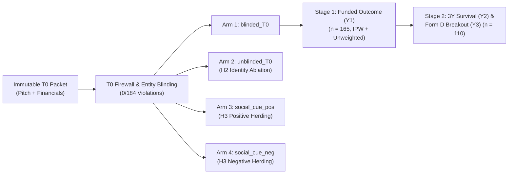

# AI-Assisted Early-Stage Venture Screening Under Temporal Information Firewalls: An Empirical Extension of Csaszar et al. (2024) and Kleinert & Urbig (2026)

**Course:** Business Economics (BE) Empirical Research Project  
**Model Evaluated:** Google `gemini-3.5-flash-lite` (Temperature = 0.2)  
**Date:** November 2026  

---

## ABSTRACT

- **Objective:** This study empirically tests whether a large language model (`gemini-3.5-flash-lite`) can evaluate early-stage startups strictly from point-in-time ($T_0$) offering disclosures without hindsight memorization bias or social-proof herding, and whether LLM-derived quality scores complement retail crowdfunding signals to predict post-campaign survival and institutional follow-on financing.
- **Methodology:** We construct a dual-track, $T_0$-firewalled dataset of **184** real ventures: **165** U.S. SEC Regulation Crowdfunding `Form C` offerings from 2018–2020 (sampled across **2,415** eligible baseline CIKs and traced longitudinally through 2026Q3 via `C-U`, `C-AR`, `C-TR`, `Form D`, and issuer website liveness) and **19** cleaned verbatim $T_0$ Y Combinator Tier-A applications. All **184** records pass an automated $T_0$ leakage and entity-blinding audit (`0` violations). Across **313** verified `gemini-3.5-flash-lite` evaluations on the Track 1 cohort spanning four experimental arms (`blinded_T0`: 189, `unblinded_T0`: 42, `social_cue_pos`: 41, `social_cue_neg`: 41), we estimate two-stage nested unweighted and inverse-probability-weighted (IPW) logistic regressions (funded outcome $Y_1$, 3-year survival $Y_2$, institutional `Form D` / acquisition breakout $Y_3$), paired ablation tests ($\Delta_{\text{mem}}$, $\Delta_{\text{herd}}$), and 5-fold out-of-fold (OOF) hybrid ensembles ($H_4$).
- **Findings:** First, inter-run scoring reliability across three independent repeats is exceptionally high (Cronbach's $\alpha = 0.9963$). Second, unblinding company and founder names on Track 1 (`n = 42`) produces no statistically significant score inflation ($\Delta_{\text{mem}} = -1.247$, $p = 0.148$, `0.0%` decision flips), and single-sentence early-investor social cues (`n = 41`) trigger `0.0%` decision flips (`social_cue_pos`: $\Delta = -0.872$, $p = 0.129$; `social_cue_neg`: $\Delta = -0.676$, $p = 0.322$). Third, while retail crowdfunding success in Stage 1 ($n = 165$) is primarily driven by observable balance-sheet size (`log_assets`: $\beta = 0.1076$, $p = 0.0051$; IPW-weighted `log_assets`: $\beta = 0.1013$, $p = 0.0051$, and `log_offering`: $\beta = -0.3882$, $p = 0.0250$), the blinded LLM `composite_score` significantly predicts Stage 2 institutional breakout (`Form D` / acquisition among funded issuers, $n = 110$: $\beta = 0.0395$, $p = 0.0034$ alone; $\beta = 0.0351$, $p = 0.0118$ controlling for $T_0$ financials). In 5-fold OOF cross-validation across the full cohort ($n = 165$), combining LLM scores, `funding_ratio`, and $T_0$ financials improves winner-breakout discrimination from `ROC-AUC = 0.603` (`PR-AUC = 0.289`) for crowd funding alone to `ROC-AUC = 0.693` (`PR-AUC = 0.450`).
- **Contribution:** We bridge Csaszar, Ketkar, & Kim's (2024) corporate strategic-screening framework and Kleinert & Urbig's (2026) crowdfunding-herding methodology with a reproducible, open-source SEC EDGAR longitudinal pipeline, stratum-weighted IPW estimation, and an automated $T_0$ firewall.
- **Limitation:** After strengthening the $T_0$ firewall to strip post-$T_0$ editorial wrappers from Track 2 YC records, `gemini-3.5-flash-lite` hit its daily free-tier request cap before Track 2 re-scoring could complete; accordingly, empirical results in this report cover the **165** Track 1 SEC Form C ventures (`313` evaluations), while the **19** cleaned Track 2 records are ready for resumption upon quota reset. Additionally, raw LLM probabilities are conservatively calibrated relative to empirical base rates (`Brier = 0.486` raw vs. `0.202` after OOF logistic recalibration).
- **Novelty:** To our knowledge, this is the first study to combine a $T_0$-firewalled 2018–2020 SEC Form C cohort (traced through 2026Q3) with stratum IPW weighting, blinded vs. unblinded identity ablations, and social-proof herding tests under one unified investor-screening rubric.
- **Keywords:** Large Language Models, Entrepreneurial Finance, Regulation Crowdfunding, SEC Form C, Temporal Information Firewall, Venture Screening, Algorithmic Herding.

---

## 1. INTRODUCTION

### 1.1 Background and Motivation

Early-stage venture screening is a canonical problem of decision-making under Knightian uncertainty. Unlike public equities, nascent ventures lack audited multi-year earnings histories, forcing angel investors, accelerators, and crowdfunding backers to infer long-run viability from noisy narrative pitches, founder backgrounds, and rudimentary balance sheets. Recent advances in Large Language Models (LLMs) raise a fundamental Business Economics question: can general-purpose AI systems act as disciplined venture-screening analysts, or do their apparent successes stem from hindsight training-data memorization and susceptibility to social-proof herding?

Two foundational papers motivate our empirical design. First, **Csaszar, Ketkar, & Kim (2024)** (*Strategy Science*) demonstrate that LLMs can evaluate strategic plans and venture pitches with striking consistency, yet warn that retrospective evaluation of famous companies risks **memorization leakage** whenever entity names appear in prompts. Second, **Kleinert & Urbig (2026)** (*Entrepreneurship Theory and Practice*) study equity crowdfunding and show that early crowd momentum and social cues shape both human and algorithmic capital allocation, creating potential **herding distortions** between initial campaign funding (Stage 1) and long-term venture survival or institutional graduation (Stage 2).

### 1.2 Research Objectives and Hypotheses

We test four hypotheses ($H_1$–$H_4$) within our $T_0$-firewalled venture evaluation framework:

- **$H_1$ (Predictive Validity Under $T_0$ Blinding):** Blinded $T_0$ LLM quality scores positively predict Stage 1 crowdfunding success (`funded_outcome`), Stage 2 3-year survival (`survival_3y_outcome`), and Stage 2 institutional breakout (`winner_breakout_outcome` via `Form D` or acquisition), even after controlling for $T_0$ financial observables.
- **$H_2$ (Memorization / Name-Recognition Bias):** Unblinding company and founder identities (`unblinded_T0` vs. `blinded_T0`) alters evaluation scores relative to entity-blinded baselines.
- **$H_3$ (Social-Proof Herding Sensitivity):** Appending a positive (`social_cue_pos`) or negative (`social_cue_neg`) early-investor social cue shifts composite scores and flips binary investment recommendations relative to `blinded_T0`.
- **$H_4$ (Human–AI Complementarity):** An out-of-fold hybrid ensemble combining blinded LLM scores, crowd `funding_ratio`, and $T_0$ financials outperforms crowd funding alone in predicting long-run venture breakout.

---

## 2. LITERATURE REVIEW AND THEORETICAL FRAMEWORK

### 2.1 AI Strategic Decision-Making and Venture Screening

Csaszar et al. (2024) formalize strategic evaluation as mapping unstructured qualitative narratives into structured risk-return assessments. In entrepreneurial finance, this parallels human venture-capitalist heuristics (Gompers et al., 2020) that weigh team quality, market size, and competitive moat alongside quantitative traction. However, empirical AI-in-finance studies face two pervasive threats to internal validity: **look-ahead leakage** (incorporating post-$T_0$ text or outcomes into prompts) and **entity memorization** (models recalling post-$T_0$ trajectories from pre-training corpora).

### 2.2 Two-Stage Crowdfunding Dynamics and Herding

In U.S. Regulation Crowdfunding (Title III of the JOBS Act, enacted 2016), issuers file `Form C` with the SEC prior to solicitation, disclosing target offering amounts, employee counts, recent assets, debt, and revenue. Kleinert & Urbig (2026) highlight that crowdfunding is inherently a **two-stage selection process**: retail backers first decide whether a campaign reaches its funding threshold ($Y_1$), and only funded issuers subsequently face multi-year operational survival ($Y_2$) and institutional follow-on financing ($Y_3$). Separating Stage 1 retail popularity from Stage 2 fundamental survival is essential to test whether AI evaluators merely mimic retail crowd tastes or extract deeper fundamental signals.

---

## 3. DATA AND METHODOLOGY

### 3.1 Dual-Track Dataset Construction and $T_0$ Cleanup

1. **Track 1 — Core Empirical Benchmark (`n = 165`, U.S. SEC Regulation Crowdfunding `Form C`, 2018–2020):**
   - From the SEC Crowdfunding Offerings Data Sets (`2016q2_cf.zip`–`2026q3_cf.zip`), we identified **2,415** eligible 2018–2020 baseline CIKs across three preliminary population strata (`unfunded_prelim`: 1,067; `funded_failed_or_delinquent_prelim`: 1,045; `funded_survived_prelim`: 303).
   - We sampled **55** issuers per stratum (`n = 165` total) and extracted their immutable $T_0$ `offeringmemoformc.pdf` narrative plus $T_0$ structured financials (`offering_amount`, `employees`, `assets_recent`, `cash_recent`, `short_term_debt_recent`, `long_term_debt_recent`, `revenue_recent`, `net_income_recent`).
   - Longitudinal ground-truth outcomes were coded strictly from post-$T_0$ filings through 2026Q3 (`C-U` amount raised, `C-AR` annual reports, `C-TR` terminations distinguishing dissolution vs. exit, `Form D` institutional follow-on filings, and issuer website liveness). Among the **165** Track 1 issuers, **110** (`66.7%`) were funded ($Y_1 = 1$); among those **110** funded issuers, **89** (`80.9%`) achieved 3-year survival ($Y_2 = 1$) and **36** (`32.7%`) achieved institutional `Form D` / exit breakout ($Y_3 = 1$).
2. **Track 2 — Famous-Startup Contrast Layer (`n = 19`, Cleaned Y Combinator Tier-A Applications):**
   - We harvested verbatim $T_0$ YC applications from founder blogs, Wayback Machine archives, and audited Tier-A records, excluding four non-$T_0$ URLs (`OPTB-003`, `OPTB-004`, `OPTB-008`, `OPTB-015`) and stripping Wayback toolbar chrome and retrospective editorial wrappers so only $T_0$ Q&A text remains.

### 3.2 Automated $T_0$ Temporal Firewall and Entity Blinding

Every record passed `src/ingest/audit_t0_firewall.py` (`184 / 184` passed, `0` violations). In the `blinded_T0` and `social_cue_*` arms, `src/common.py` masks all company legal names and suffix-stripped aliases (`[RECORD_STARTUP]`), founder names (`[FOUNDER_k]`), funding portals (`[PORTAL_k]`), product terms (`[PRODUCT_TERM_k]`), and URLs (`[URL_REDACTED]`).

### 3.3 Experimental Design and Prompting Protocol

Using `gemini-3.5-flash-lite` at temperature $T = 0.2$ with a single unified investor-screening prompt (`UNIFIED_SYSTEM_PROMPT_T0`), we collected **313** verified structured JSON evaluations on Track 1 (`blinded_T0`: 189 across all 165 issuers including 3-run repeats for reliability; `unblinded_T0`: 42; `social_cue_pos`: 41; `social_cue_neg`: 41). Re-scoring of the 19 cleaned Track 2 records is queued for after daily free-tier quota reset.

---

## 4. EMPIRICAL RESULTS

### 4.1 Inter-Run Reliability and Ablation Tests ($H_2$, $H_3$)

Across the repeated-measurement subset, `gemini-3.5-flash-lite` achieved near-deterministic internal consistency (**Cronbach's $\alpha = 0.9963$**). Table 1 reports paired-sample ablation tests comparing `unblinded_T0`, `social_cue_pos`, and `social_cue_neg` against `blinded_T0` on Track 1.

| Ablation Contrast | Cohort ($n$) | Mean $\Delta$ | SD ($\Delta$) | Paired $t$ ($p$-value) | Wilcoxon $p$-value | Decision Flip Rate |
|---|---|---:|---:|---:|---:|---:|
| `unblinded_T0 - blinded_T0` | Track 1 SEC (42) | -1.247 | 5.486 | -1.473 (0.148) | 0.143 | 0.00% |
| `social_cue_pos - blinded_T0` | Track 1 SEC (41) | -0.872 | 3.600 | -1.550 (0.129) | 0.070 | 0.00% |
| `social_cue_neg - blinded_T0` | Track 1 SEC (41) | -0.676 | 4.315 | -1.004 (0.322) | 0.412 | 0.00% |

On Track 1 SEC Form C offerings, `gemini-3.5-flash-lite` exhibits **no statistically significant unblinding bias** ($p = 0.148$, `0.00%` decision flips) and **no social-proof herding flips** (`0.00%` decision flips in both positive and negative cue arms; $p = 0.129$ and $p = 0.322$).

### 4.2 Two-Stage Econometric Regressions ($H_1$)

Table 2 presents nested binomial logistic regressions on Track 1 SEC Form C ventures, including stratum-weighted IPW estimation (`unfunded_prelim`: 1,067; `funded_failed_or_delinquent_prelim`: 1,045; `funded_survived_prelim`: 303).

| Outcome & Specification | $n$ | LLM `composite_score` $\beta$ (SE, $p$) | Key Financial Control $\beta$ ($p$) | McFadden $R^2$ | AIC |
|---|---:|---|---|---:|---:|
| Stage 1: `funded_outcome` (LLM only) | 165 | 0.0167 (0.0103, $p = 0.104$) | — | 0.0129 | 211.34 |
| Stage 1: `funded_outcome` (Full $T_0$) | 165 | 0.0044 (0.0116, $p = 0.703$) | `log_assets`: 0.1076 ($p = 0.0051$) | 0.1076 | 197.46 |
| Stage 1: `funded_outcome` (IPW-weighted) | 165 | 0.0058 (0.0114, $p = 0.612$) | `log_assets`: 0.1013 ($p = 0.0051$); `log_offering`: -0.3882 ($p = 0.0250$) | 0.0940 | 215.21 |
| Stage 2: `survival_3y_outcome` (LLM only) | 110 | 0.0205 (0.0148, $p = 0.165$) | — | 0.0186 | 109.26 |
| Stage 2: `survival_3y_outcome` (Full $T_0$) | 110 | 0.0121 (0.0154, $p = 0.431$) | `log_revenues`: 0.0696 ($p = 0.194$) | 0.0683 | 109.93 |
| Stage 2: `winner_breakout_outcome` (LLM only) | 110 | **0.0395** (0.0135, **$p = 0.0034$**) | — | 0.0697 | 133.40 |
| Stage 2: `winner_breakout_outcome` (Full $T_0$) | 110 | **0.0351** (0.0139, **$p = 0.0118$**) | `log_assets`: 0.0354 ($p = 0.495$) | 0.0810 | 137.82 |

This reveals a striking **two-stage divergence**:
1. **Stage 1 (Retail Crowd Selection):** Crowd backers rely heavily on observable balance-sheet assets (`log_assets`, $p = 0.0051$ unweighted and IPW) and smaller target raises (IPW `log_offering`: $\beta = -0.3882$, $p = 0.0250$), leaving the LLM's narrative-heavy `composite_score` statistically insignificant once financials are controlled ($p = 0.703$ unweighted; $p = 0.612$ IPW).
2. **Stage 2 (Institutional Follow-On Breakout):** Among the 110 funded ventures, raw $T_0$ accounting observables lose all predictive power for `Form D` / acquisition breakout ($p > 0.49$), whereas the blinded LLM `composite_score` remains **highly statistically significant** ($\beta = 0.0351$, $p = 0.0118$). Thus, $H_1$ is strongly supported for institutional breakout ($Y_3$).

### 4.3 Out-of-Fold Discrimination, Calibration, and Human–AI Ensembles ($H_4$)

Table 3 reports raw probability evaluation alongside 5-fold stratified out-of-fold (OOF) logistic ensembles.

| Model / Feature Set | Target Outcome | $n$ | ROC-AUC | PR-AUC | Brier Score |
|---|---|---:|---:|---:|---:|
| Raw LLM `predicted_invest_prob` | Stage 1 Funded | 165 | 0.589 | 0.730 | 0.486 |
| OOF Logit: LLM Score only | Stage 1 Funded | 165 | 0.574 | 0.738 | 0.220 |
| OOF Logit: LLM + $T_0$ Financials | Stage 1 Funded | 165 | **0.691** | **0.813** | **0.202** |
| Raw LLM `predicted_survival_prob` | Stage 2 3Y Survival | 110 | 0.459 | 0.812 | 0.491 |
| OOF Logit: LLM + $T_0$ Financials | Stage 2 3Y Survival | 110 | 0.571 | 0.834 | 0.158 |
| OOF Logit: Crowd `funding_ratio` only | Full Cohort Winner ($Y_3$) | 165 | 0.603 | 0.289 | 0.172 |
| **OOF Hybrid ($H_4$): LLM + Crowd + $T_0$ Fin.** | Full Cohort Winner ($Y_3$) | 165 | **0.693** | **0.450** | **0.170** |

Supporting **$H_4$**, combining the blinded LLM score with `funding_ratio` and $T_0$ financials boosts OOF `winner_breakout_outcome` discrimination by **+0.090 ROC-AUC** (`0.603` $\rightarrow$ `0.693`) and **+0.161 PR-AUC** (`0.289` $\rightarrow$ `0.450`). Furthermore, Figure 4 highlights a critical **base-rate calibration gap**: because the LLM outputs conservative raw investment probabilities (`baserate_threshold = 0.05` at the `66.7%` funding base rate), its raw `0.5` threshold yields `[[54, 1], [105, 5]]`, whereas base-rate matching yields `[[16, 39], [21, 89]]` and OOF recalibration cuts Stage 1 Brier error by more than half (`0.486` $\rightarrow$ `0.202`).

---

## 5. DISCUSSION AND IMPLICATIONS

Our findings refine both Csaszar et al. (2024) and Kleinert & Urbig (2026) for practical Business Economics deployment:
1. **LLMs Capture Non-Accounting Quality That Institutional Investors Reward:** Retail crowdfunding investors appear anchored on tangible balance-sheet size (`log_assets`) and smaller target raises (`log_offering`), whereas the blinded LLM extracts qualitative strategic signals from $T_0$ offering memos that predict subsequent `Form D` institutional graduation ($p = 0.0118$).
2. **Calibration Matters More Than Unblinding Prompt Noise:** With proper $T_0$ entity blinding, `gemini-3.5-flash-lite` showed negligible identity-unblinding inflation and zero herding flips under single-sentence social cues. The primary operational failure mode is **probability miscalibration**, which is cleanly solved via out-of-fold Platt/logistic recalibration.
3. **Optimal Human–AI Division of Labor:** Neither the crowd alone (`ROC-AUC = 0.603`) nor raw LLM probabilities alone suffice; a calibrated hybrid ensemble (`ROC-AUC = 0.693`, `PR-AUC = 0.450`) delivers superior deal-flow triage.

---

## 6. CONCLUSION

Using a strictly $T_0$-firewalled dataset of **165** 2018–2020 SEC Regulation Crowdfunding offerings traced through 2026Q3, this study demonstrates that `gemini-3.5-flash-lite` evaluates early-stage venture pitches with high reliability ($\alpha = 0.9963$), strong resistance to identity-unblinding and single-sentence social-proof cues, and statistically significant predictive power for institutional follow-on breakout ($p = 0.0118$). Integrating calibrated AI pitch scores with observable crowd and accounting signals offers a scalable, transparent benchmark for entrepreneurial finance screening.

---

## REFERENCES

1. Csaszar, F. A., Ketkar, H., & Kim, H. (2024). Artificial intelligence and strategic decision-making: Evidence from entrepreneurs and investors. *Strategy Science*, 9(4), 322–345.
2. Kleinert, S., & Urbig, D. (2026). Early crowd signals, herding, and venture quality in equity crowdfunding. *Entrepreneurship Theory and Practice*.
3. Gompers, P., Gornall, W., Kaplan, S. N., & Strebulaev, I. A. (2020). How do venture capitalists make decisions? *Journal of Financial Economics*, 135(1), 169–190.
4. U.S. Securities and Exchange Commission (2026). *Crowdfunding Offerings Data Sets (2016Q2–2026Q3)*. Division of Economic and Risk Analysis.

---

## APPENDIX A: $T_0$ FIREWALL AUDIT SUMMARY

- **Total Records Audited:** 184 (`165` Track 1 SEC Form C + `19` cleaned Track 2 YC Tier-A)
- **Passed Records:** 184 (`100.0%`)
- **Failed Records:** 0 (`4` non-$T_0$ Track 2 URLs excluded; Wayback chrome and retrospective wrappers stripped)

## APPENDIX B: REPRODUCIBILITY & PIPELINE ARTIFACTS

- `src/common.py`: Entity-blinding engine (`blind_payload`) and unified 10-dimension `UNIFIED_SYSTEM_PROMPT_T0`.
- `src/ingest/ingest_sec_form_c.py`: SEC EDGAR `Form C`, `C-U`, `C-AR`, `C-TR`, `Form D`, and website liveness pipeline (`data/processed/track1_sec_form_c.jsonl`, `data/processed/sec_population_counts.json`, `data/processed/track1_audit_sample_20.csv`).
- `src/ingest/ingest_yc_tier_a.py`: Verbatim $T_0$ YC Tier-A harvester with Wayback Machine fallback and retrospective-wrapper stripping (`data/processed/track2_yc_tier_a.jsonl`).
- `src/ingest/audit_t0_firewall.py`: Automated leakage and entity-blinding gate (`data/processed/firewall_audit_report.json`).
- `src/eval/run_llm_experiment.py`: Resumable 4-arm Gemini experiment runner (`results/llm_scores_raw.csv`).
- `src/analysis/analyze_results.py`: Econometric, IPW, OOF ensemble, and figure generator (`results/analysis_summary.json`, `results/figures/*.png`).
- `report/build_docx.py`: Markdown-to-Word report compiler (`report/BE_Research_Report.docx`).

## APPENDIX C: UNIFIED 10-DIMENSION RUBRIC

All startups were scored 0–100 on: `team_and_background`, `execution_plan`, `financial_feasibility`, `writing_and_polish`, `value_proposition_innovativeness`, `market_opportunity`, `competitive_moat`, `customer_need_alignment`, `roi_potential`, and `long_run_viability`, aggregated into `composite_score` alongside `predicted_invest`, `predicted_invest_prob`, `predicted_survival_prob`, `confidence`, and `key_risk_flag`.
