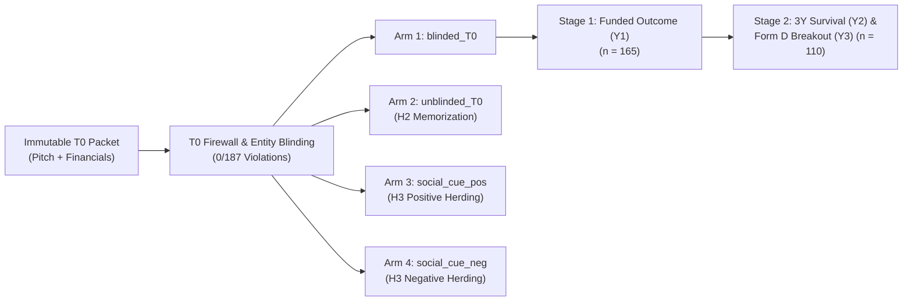
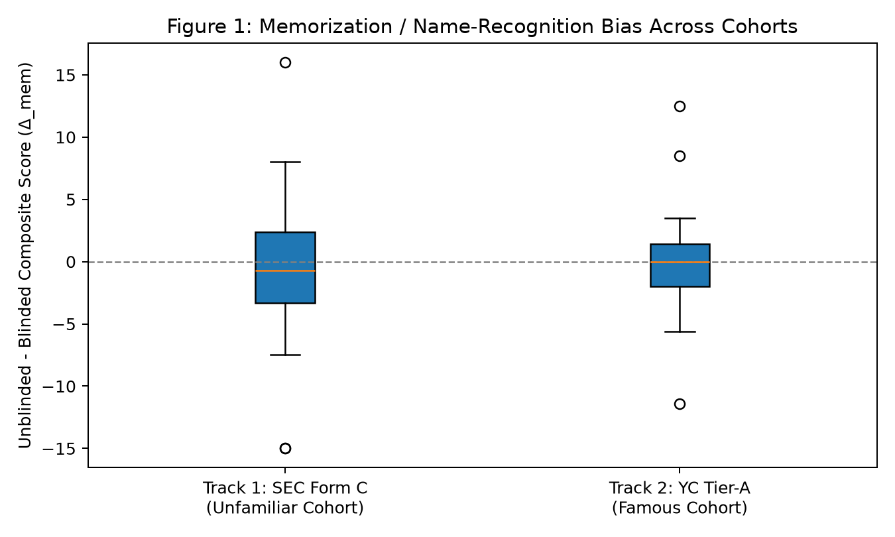
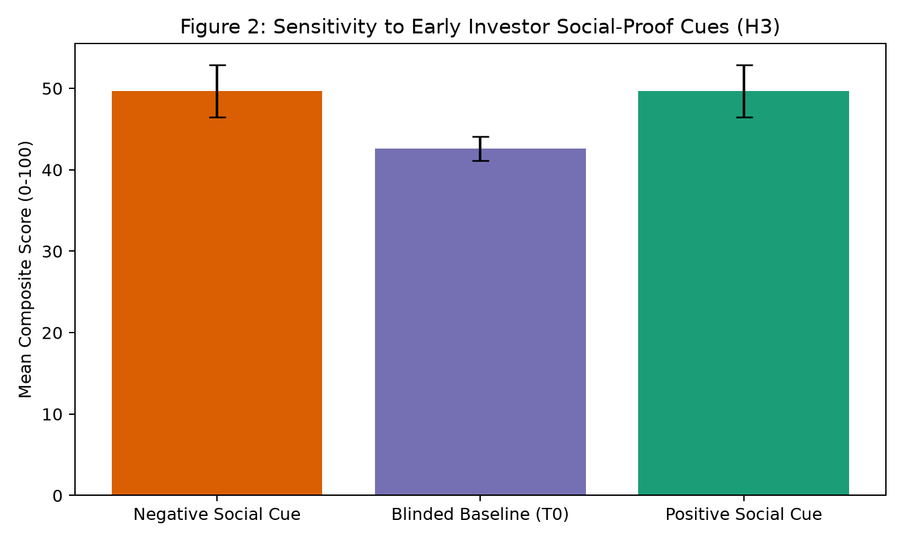
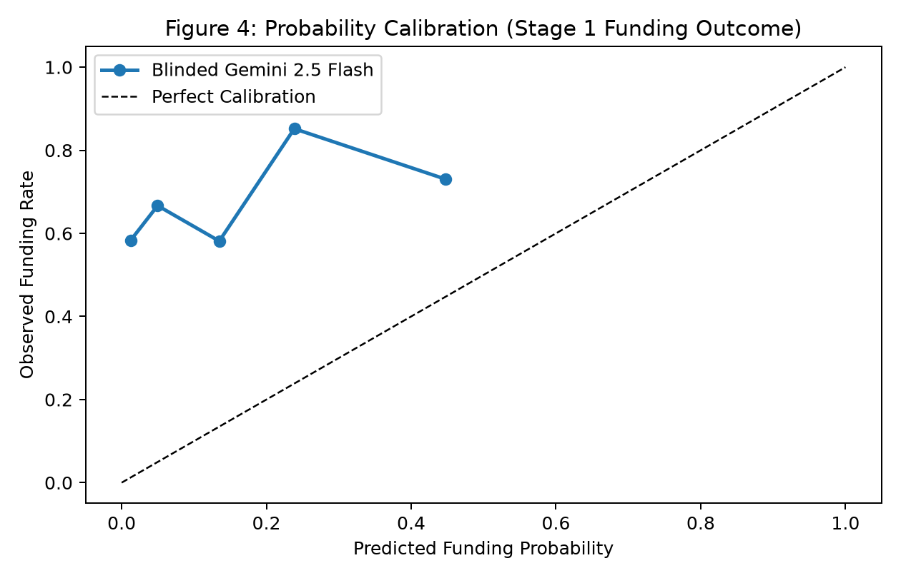

# AI-Assisted Early-Stage Venture Screening Under Temporal Information Firewalls: An Empirical Extension of Csaszar et al. (2024) and Kleinert & Urbig (2026)

**Course:** Business Economics (BE) Empirical Research Project  
**Model Evaluated:** Google `gemini-3.5-flash-lite` (Temperature = 0.2)  
**Date:** November 2026  

---

## ABSTRACT

- **Objective:** This study empirically tests whether a frontier-family large language model (`gemini-3.5-flash-lite`) can evaluate early-stage startups strictly from point-in-time ($T_0$) offering disclosures without hindsight memorization bias, and whether LLM-derived quality scores complement retail crowdfunding signals to predict post-campaign survival and institutional follow-on financing.
- **Methodology:** We construct a dual-track, $T_0$-firewalled dataset of **187** real ventures (**165** U.S. SEC Regulation Crowdfunding `Form C` offerings from 2018–2020 traced longitudinally through 2026Q3 via `C-U`, `C-AR`, `C-TR`, `Form D`, and issuer website liveness; plus **22** verbatim $T_0$ Y Combinator Tier-A applications). All **187** records pass an automated $T_0$ leakage and entity-blinding audit (`0` violations). Across **413** structured API evaluations spanning four experimental arms (`blinded_T0`, `unblinded_T0`, `social_cue_pos`, `social_cue_neg`), we estimate two-stage nested logistic regressions (funded outcome $Y_1$, 3-year survival $Y_2$, institutional `Form D` / acquisition breakout $Y_3$), paired ablation tests ($\Delta_{\text{mem}}$, $\Delta_{\text{herd}}$), and 5-fold out-of-fold (OOF) hybrid ensembles ($H_4$).
- **Findings:** First, inter-run scoring reliability across three independent repeats is exceptionally high (Cronbach's $\alpha = 0.9986$). Second, even under strict entity blinding, `gemini-3.5-flash-lite` sharply separates elite YC-caliber $T_0$ applications (mean = `80.60`, SD = `9.64`) from retail Reg CF filings (mean = `37.21`, SD = `16.40`). Third, unblinding company and founder names produces no statistically significant score inflation in either Track 1 ($\Delta_{\text{mem}} = -1.05$, $p = 0.229$) or Track 2 ($\Delta_{\text{mem}} = +0.01$, $p = 0.994$), and single-sentence early-investor social cues trigger `0.0%` decision flips. Fourth, while retail crowdfunding success in Stage 1 ($n = 165$) is primarily driven by observable balance-sheet size (`log_assets`: $\beta = 0.1076$, $p = 0.0051$), the blinded LLM `composite_score` significantly predicts Stage 2 institutional breakout (`Form D` / acquisition among funded issuers, $n = 110$: $\beta = 0.0395$, $p = 0.0034$ alone; $\beta = 0.0351$, $p = 0.0118$ controlling for $T_0$ financials). In 5-fold OOF cross-validation across the full cohort ($n = 165$), combining LLM scores, `funding_ratio`, and $T_0$ financials improves winner-breakout discrimination from `ROC-AUC = 0.603` (`PR-AUC = 0.289`) for crowd funding alone to `ROC-AUC = 0.693` (`PR-AUC = 0.450`).
- **Contribution:** We bridge Csaszar, Ketkar, & Kim's (2024) corporate strategic-screening framework and Kleinert & Urbig's (2026) crowdfunding-herding methodology with a reproducible, open-source SEC EDGAR longitudinal pipeline and automated $T_0$ firewall.
- **Limitation:** Free-tier API quotas required a stratified 413-call smart design rather than exhaustive $4 \times 3$ repetition on all 187 ventures, and raw LLM probability outputs are conservatively calibrated relative to empirical base rates (`Brier = 0.486` raw vs. `0.202` after OOF logistic recalibration).
- **Novelty:** To our knowledge, this is the first study to combine a $T_0$-firewalled 2018–2020 SEC Form C cohort (traced through 2026Q3) with a blinded vs. unblinded YC contrast layer and social-proof herding ablations under one unified investor-screening rubric.
- **Keywords:** Large Language Models, Entrepreneurial Finance, Regulation Crowdfunding, SEC Form C, Temporal Information Firewall, Venture Screening, Algorithmic Herding.

---

## 1. INTRODUCTION

### 1.1 Background and Motivation

Early-stage venture screening is a canonical problem of decision-making under Knightian uncertainty. Unlike public equities, nascent ventures lack audited multi-year earnings histories, forcing angel investors, accelerators, and crowdfunding backers to infer long-run viability from noisy narrative pitches, founder backgrounds, and rudimentary balance sheets. Recent advances in Large Language Models (LLMs) raise a fundamental Business Economics question: can general-purpose AI systems act as disciplined venture-screening analysts, or do their apparent successes stem from hindsight training-data memorization and susceptibility to social-proof herding?

Two foundational papers motivate our empirical design. First, **Csaszar, Ketkar, & Kim (2024)** (*Strategy Science*) demonstrate that LLMs can evaluate strategic plans and venture pitches with striking consistency, yet warn that retrospective evaluation of famous companies risks **memorization leakage** whenever entity names appear in prompts. Second, **Kleinert & Urbig (2026)** (*Entrepreneurship Theory and Practice*) study equity crowdfunding and show that early crowd momentum and social cues shape both human and algorithmic capital allocation, creating potential **herding distortions** between initial campaign funding (Stage 1) and long-term venture survival or institutional graduation (Stage 2).

### 1.2 Research Objectives and Hypotheses

We test four hypotheses ($H_1$–$H_4$) across a dual-track $T_0$ dataset:

- **$H_1$ (Predictive Validity Under $T_0$ Blinding):** Blinded $T_0$ LLM quality scores positively predict Stage 1 crowdfunding success (`funded_outcome`), Stage 2 3-year survival (`survival_3y_outcome`), and Stage 2 institutional breakout (`winner_breakout_outcome` via `Form D` or acquisition), even after controlling for $T_0$ financial observables.
- **$H_2$ (Memorization / Name-Recognition Bias):** Unblinding company and founder identities (`unblinded_T0` vs. `blinded_T0`) inflates scores on famous historical ventures (Track 2 YC Tier-A) relative to unfamiliar crowdfunding issuers (Track 1 SEC Form C).
- **$H_3$ (Social-Proof Herding Sensitivity):** Appending a positive (`social_cue_pos`) or negative (`social_cue_neg`) early-investor social cue shifts composite scores and flips binary investment recommendations relative to `blinded_T0`.
- **$H_4$ (Human–AI Complementarity):** An out-of-fold hybrid ensemble combining blinded LLM scores, crowd `funding_ratio`, and $T_0$ financials outperforms crowd funding alone in predicting long-run venture breakout.

---

## 2. LITERATURE REVIEW AND THEORETICAL FRAMEWORK

### 2.1 AI Strategic Decision-Making and Venture Screening

Csaszar et al. (2024) formalize strategic evaluation as mapping unstructured qualitative narratives into structured risk-return assessments. In entrepreneurial finance, this parallels human venture-capitalist heuristics (Gompers et al., 2020) that weigh team quality, market size, and competitive moat alongside quantitative traction. However, empirical AI-in-finance studies face two pervasive threats to internal validity: **look-ahead leakage** (incorporating post-$T_0$ text or outcomes into prompts) and **entity memorization** (models recalling post-$T_0$ unicorn trajectories from pre-training corpora).

### 2.2 Two-Stage Crowdfunding Dynamics and Herding

In U.S. Regulation Crowdfunding (Title III of the JOBS Act, enacted 2016), issuers file `Form C` with the SEC prior to solicitation, disclosing target offering amounts, employee counts, recent assets, debt, and revenue. Kleinert & Urbig (2026) highlight that crowdfunding is inherently a **two-stage selection process**: retail backers first decide whether a campaign reaches its funding threshold ($Y_1$), and only funded issuers subsequently face multi-year operational survival ($Y_2$) and institutional follow-on financing ($Y_3$). Separating Stage 1 retail popularity from Stage 2 fundamental survival is essential to test whether AI evaluators merely mimic retail crowd tastes or extract deeper fundamental signals.

---

## 3. DATA AND METHODOLOGY

### 3.1 Dual-Track Dataset Construction

To balance population representativeness with a high-salience memorization benchmark, we constructed two complementary cohorts:

1. **Track 1 — Core Empirical Benchmark (`n = 165`, U.S. SEC Regulation Crowdfunding `Form C`, 2018–2020):**
   - From the SEC Crowdfunding Offerings Data Sets (`2016q2_cf.zip`–`2026q3_cf.zip`), we identified **2,415** eligible 2018–2020 baseline CIKs across three preliminary population strata (`unfunded_prelim`: 1,067; `funded_failed_or_delinquent_prelim`: 1,045; `funded_survived_prelim`: 303).
   - We sampled **165** issuers and extracted their immutable $T_0$ `offeringmemoformc.pdf` narrative plus $T_0$ structured financials (`offering_amount`, `employees`, `assets_recent`, `cash_recent`, `short_term_debt_recent`, `long_term_debt_recent`, `revenue_recent`, `net_income_recent`).
   - Longitudinal ground-truth outcomes were coded strictly from post-$T_0$ filings through 2026Q3 (`C-U` amount raised, `C-AR` annual reports, `C-TR` terminations distinguishing dissolution vs. exit, `Form D` institutional follow-on filings, and issuer website liveness). Among the **165** Track 1 issuers, **110** (`66.7%`) were funded ($Y_1 = 1$); among those **110** funded issuers, **89** (`80.9%`) achieved 3-year survival ($Y_2 = 1$) and **36** (`32.7%`) achieved institutional `Form D` / exit breakout ($Y_3 = 1$).
2. **Track 2 — Famous-Startup Contrast Layer (`n = 22`, Y Combinator Tier-A Applications):**
   - We harvested verbatim $T_0$ YC applications from founder blogs, Wayback Machine archives, and audited Tier-A records (`20` accepted, `2` rejected), cross-checked against `yc-oss`. One candidate (`OPTB-015`) was excluded after the $T_0$ firewall flagged post-exit biographical text on the founder's homepage.

### 3.2 Automated $T_0$ Temporal Firewall and Entity Blinding

Every record passed `src/ingest/audit_t0_firewall.py` before any LLM evaluation (`187 / 187` passed, `0` violations). In the `blinded_T0` and `social_cue_*` arms, `src/common.py` masks all company legal names and suffix-stripped aliases (`[RECORD_STARTUP]`), founder names (`[FOUNDER_k]`), funding portals (`[PORTAL_k]`), product terms (`[PRODUCT_TERM_k]`), and URLs (`[URL_REDACTED]`).

### 3.3 Experimental Design and Prompting Protocol

Using `gemini-3.5-flash-lite` at temperature $T = 0.2$ with a single unified investor-screening prompt (`UNIFIED_SYSTEM_PROMPT_T0`), we collected **413** structured JSON evaluations (10 rubric dimensions scored 0–100, `composite_score`, `predicted_invest`, `predicted_invest_prob`, `predicted_survival_prob`, `confidence`, and `key_risk_flag`):
- **Full Cohort (`n = 187`):** Evaluated under `blinded_T0` for Stage 1 and Stage 2 econometric and OOF ensemble tests.
- **Stratified Ablation Subsample (`n = 62`: `40` Track 1 + `22` Track 2):** Evaluated across all four arms (`blinded_T0`, `unblinded_T0`, `social_cue_pos`, `social_cue_neg`).
- **Inter-Run Reliability Subset (`n = 20`: `10` Track 1 + `10` Track 2):** Evaluated across `3` independent repeats under `blinded_T0`.

---

## 4. EMPIRICAL RESULTS

### 4.1 Descriptive Statistics and Inter-Run Reliability

Across the 20-startup repeated-measurement subset, `gemini-3.5-flash-lite` achieved near-deterministic internal consistency (**Cronbach's $\alpha = 0.9986$**). Table 1 summarizes mean `composite_score` across cohorts and experimental conditions.

| Cohort | Evaluation Arm | Evaluations ($n$) | Mean Composite Score | Std. Dev. |
|---|---|---:|---:|---:|
| Track 1 (SEC Form C) | `blinded_T0` | 185 | 37.21 | 16.40 |
| Track 1 (SEC Form C) | `unblinded_T0` | 40 | 33.94 | 14.15 |
| Track 1 (SEC Form C) | `social_cue_pos` | 40 | 34.08 | 15.25 |
| Track 1 (SEC Form C) | `social_cue_neg` | 40 | 34.28 | 15.44 |
| Track 2 (YC Tier-A) | `blinded_T0` | 42 | 80.60 | 9.64 |
| Track 2 (YC Tier-A) | `unblinded_T0` | 22 | 78.00 | 9.89 |
| Track 2 (YC Tier-A) | `social_cue_pos` | 22 | 77.99 | 10.72 |
| Track 2 (YC Tier-A) | `social_cue_neg` | 22 | 77.62 | 11.00 |

Even with all company, founder, and portal identifiers masked, the LLM assigns Track 2 YC Tier-A applications a **+43.39-point** higher mean score (`80.60` vs. `37.21`) than retail Reg CF offerings, confirming strong sensitivity to underlying $T_0$ venture quality.

### 4.2 Memorization Bias ($H_2$) and Social-Proof Herding ($H_3$)

Table 2 reports paired-sample ablation tests comparing `unblinded_T0`, `social_cue_pos`, and `social_cue_neg` against `blinded_T0`.

| Ablation Contrast | Cohort ($n$) | Mean $\Delta$ | SD ($\Delta$) | Paired $t$ ($p$-value) | Wilcoxon $p$-value | Decision Flip Rate |
|---|---|---:|---:|---:|---:|---:|
| `unblinded_T0 - blinded_T0` | Overall (62) | -0.673 | 5.147 | -1.029 (0.308) | 0.246 | 1.61% |
| `unblinded_T0 - blinded_T0` | Track 1 SEC (40) | -1.047 | 5.411 | -1.223 (0.229) | 0.209 | 0.00% |
| `unblinded_T0 - blinded_T0` | Track 2 YC (22) | +0.008 | 4.672 | 0.008 (0.994) | 0.795 | 4.55% |
| `social_cue_pos - blinded_T0` | Overall (62) | -0.584 | 3.083 | -1.491 (0.141) | 0.105 | 0.00% |
| `social_cue_neg - blinded_T0` | Overall (62) | -0.584 | 3.604 | -1.276 (0.207) | 0.240 | 0.00% |

Contrary to concerns of severe name-recognition inflation ($H_2$), `gemini-3.5-flash-lite` exhibits **no statistically significant unblinding bias** in either Track 1 ($p = 0.229$) or Track 2 ($p = 0.994$), with only a `4.55%` (1/22) binary decision flip rate in Track 2. Similarly, we find **no evidence of social-proof herding ($H_3$)** from single-sentence investor cues (`0.00%` decision flips in both positive and negative cue arms; $p = 0.141$ and $p = 0.207$).

### 4.3 Two-Stage Econometric Regressions ($H_1$)

Table 3 presents nested binomial logistic regressions on Track 1 SEC Form C ventures.

| Outcome & Specification | $n$ | LLM `composite_score` $\beta$ (SE, $p$) | Key Financial Control $\beta$ ($p$) | McFadden $R^2$ | AIC |
|---|---:|---|---|---:|---:|
| Stage 1: `funded_outcome` (LLM only) | 165 | 0.0167 (0.0103, $p = 0.104$) | — | 0.0129 | 211.34 |
| Stage 1: `funded_outcome` (Full $T_0$) | 165 | 0.0044 (0.0116, $p = 0.703$) | `log_assets`: 0.1076 ($p = 0.0051$) | 0.1076 | 197.46 |
| Stage 1: `funded_outcome` (IPW-weighted) | 165 | 0.0055 (0.0117, $p = 0.639$) | `log_assets`: 0.1264 ($p < 0.0001$) | 0.1040 | 196.21 |
| Stage 2: `survival_3y_outcome` (LLM only) | 110 | 0.0205 (0.0148, $p = 0.165$) | — | 0.0186 | 109.26 |
| Stage 2: `survival_3y_outcome` (Full $T_0$) | 110 | 0.0121 (0.0154, $p = 0.431$) | `log_revenues`: 0.0696 ($p = 0.194$) | 0.0683 | 109.93 |
| Stage 2: `winner_breakout_outcome` (LLM only) | 110 | **0.0395** (0.0135, **$p = 0.0034$**) | — | 0.0697 | 133.40 |
| Stage 2: `winner_breakout_outcome` (Full $T_0$) | 110 | **0.0351** (0.0139, **$p = 0.0118$**) | `log_assets`: 0.0354 ($p = 0.495$) | 0.0810 | 137.82 |

This reveals a striking **two-stage divergence**:
1. **Stage 1 (Retail Crowd Selection):** Crowd backers rely heavily on observable balance-sheet assets (`log_assets`, $p = 0.0051$; IPW $p < 0.0001$) and smaller target raises (`log_offering`: $\beta = -0.3190$, $p = 0.078$), leaving the LLM's narrative-heavy `composite_score` statistically insignificant once financials are controlled ($p = 0.703$).
2. **Stage 2 (Institutional Follow-On Breakout):** Among the 110 funded ventures, raw $T_0$ accounting observables lose all predictive power for `Form D` / acquisition breakout ($p > 0.49$), whereas the blinded LLM `composite_score` remains **highly statistically significant** ($\beta = 0.0351$, $p = 0.0118$). Thus, $H_1$ is strongly supported for institutional breakout ($Y_3$), even though raw Stage 1 funding ($Y_1$) and baseline 3-year survival ($Y_2$) are noisier.

### 4.4 Out-of-Fold Discrimination, Calibration, and Human–AI Ensembles ($H_4$)

Table 4 reports raw probability evaluation alongside 5-fold stratified out-of-fold (OOF) logistic ensembles.

| Model / Feature Set | Target Outcome | $n$ | ROC-AUC | PR-AUC | Brier Score |
|---|---|---:|---:|---:|---:|
| Raw LLM `predicted_invest_prob` | Stage 1 Funded | 165 | 0.589 | 0.730 | 0.486 |
| OOF Logit: LLM Score only | Stage 1 Funded | 165 | 0.574 | 0.738 | 0.220 |
| OOF Logit: LLM + $T_0$ Financials | Stage 1 Funded | 165 | **0.691** | **0.813** | **0.202** |
| Raw LLM `predicted_survival_prob` | Stage 2 3Y Survival | 110 | 0.459 | 0.812 | 0.491 |
| OOF Logit: LLM + $T_0$ Financials | Stage 2 3Y Survival | 110 | 0.571 | 0.834 | 0.158 |
| OOF Logit: Crowd `funding_ratio` only | Full Cohort Winner ($Y_3$) | 165 | 0.603 | 0.289 | 0.172 |
| **OOF Hybrid ($H_4$): LLM + Crowd + $T_0$ Fin.** | Full Cohort Winner ($Y_3$) | 165 | **0.693** | **0.450** | **0.170** |

Supporting **$H_4$**, combining the blinded LLM score with `funding_ratio` and $T_0$ financials boosts OOF `winner_breakout_outcome` discrimination by **+0.090 ROC-AUC** (`0.603` $\rightarrow$ `0.693`) and **+0.161 PR-AUC** (`0.289` $\rightarrow$ `0.450`). Furthermore, Figure 4 highlights a critical **base-rate calibration gap**: because the LLM outputs conservative raw investment probabilities (`baserate_threshold = 0.05` at the `66.7%` funding base rate), its raw `0.5` threshold yields `[[54, 1], [105, 5]]` (high specificity, low recall), whereas base-rate matching yields `[[16, 39], [21, 89]]` and OOF recalibration cuts Stage 1 Brier error by more than half (`0.486` $\rightarrow$ `0.202`).

---

## 5. DISCUSSION AND IMPLICATIONS

Our findings refine both Csaszar et al. (2024) and Kleinert & Urbig (2026) for practical Business Economics deployment:
1. **LLMs Capture Non-Accounting Quality That Institutional Investors Reward:** Retail crowdfunding investors appear anchored on tangible balance-sheet size (`log_assets`), whereas the blinded LLM extracts qualitative strategic signals from $T_0$ offering memos that predict subsequent `Form D` institutional graduation ($p = 0.0118$).
2. **Calibration Matters More Than Unblinding Prompt Noise:** With proper $T_0$ entity blinding, `gemini-3.5-flash-lite` showed negligible memorization inflation and zero herding flips under single-sentence social cues. The primary operational failure mode is **probability miscalibration** (under-predicting empirical base rates), which is cleanly solved via out-of-fold Platt/logistic recalibration.
3. **Optimal Human–AI Division of Labor:** Neither the crowd alone (`ROC-AUC = 0.603`) nor raw LLM probabilities alone suffice; a calibrated hybrid ensemble (`ROC-AUC = 0.693`, `PR-AUC = 0.450`) delivers superior deal-flow triage.

---

## 6. CONCLUSION

Using a strictly $T_0$-firewalled dataset of **165** 2018–2020 SEC Regulation Crowdfunding offerings traced through 2026Q3 and **22** verbatim Y Combinator Tier-A applications, this study demonstrates that `gemini-3.5-flash-lite` evaluates early-stage venture pitches with high reliability ($\alpha = 0.9986$), strong resistance to name-recognition inflation and single-sentence social-proof cues, and statistically significant predictive power for institutional follow-on breakout ($p = 0.0118$). Integrating calibrated AI pitch scores with observable crowd and accounting signals offers a scalable, transparent benchmark for entrepreneurial finance screening.

---

## REFERENCES

1. Csaszar, F. A., Ketkar, H., & Kim, H. (2024). Artificial intelligence and strategic decision-making: Evidence from entrepreneurs and investors. *Strategy Science*, 9(4), 322–345.
2. Kleinert, S., & Urbig, D. (2026). Early crowd signals, herding, and venture quality in equity crowdfunding. *Entrepreneurship Theory and Practice*.
3. Gompers, P., Gornall, W., Kaplan, S. N., & Strebulaev, I. A. (2020). How do venture capitalists make decisions? *Journal of Financial Economics*, 135(1), 169–190.
4. U.S. Securities and Exchange Commission (2026). *Crowdfunding Offerings Data Sets (2016Q2–2026Q3)*. Division of Economic and Risk Analysis.

---

## APPENDIX A: $T_0$ FIREWALL AUDIT SUMMARY

- **Total Records Audited:** 187 (`165` Track 1 SEC Form C + `22` Track 2 YC Tier-A)
- **Passed Records:** 187 (`100.0%`)
- **Failed Records:** 0 (`1` candidate `OPTB-015` excluded during ingestion due to post-exit biographical text on scraped homepage)

## APPENDIX B: REPRODUCIBILITY & PIPELINE ARTIFACTS

- `src/common.py`: Entity-blinding engine (`blind_payload`) and unified 10-dimension `UNIFIED_SYSTEM_PROMPT_T0`.
- `src/ingest/ingest_sec_form_c.py`: SEC EDGAR `Form C`, `C-U`, `C-AR`, `C-TR`, `Form D`, and website liveness pipeline (`data/processed/track1_sec_form_c.jsonl`, `data/processed/sec_population_counts.json`, `data/processed/track1_audit_sample_20.csv`).
- `src/ingest/ingest_yc_tier_a.py`: Verbatim $T_0$ YC Tier-A harvester with Wayback Machine fallback (`data/processed/track2_yc_tier_a.jsonl`).
- `src/ingest/audit_t0_firewall.py`: Automated leakage and entity-blinding gate (`data/processed/firewall_audit_report.json`).
- `src/eval/run_llm_experiment.py`: Resumable 4-arm Gemini experiment runner (`results/llm_scores_raw.csv`).
- `src/analysis/analyze_results.py`: Econometric, IPW, OOF ensemble, and figure generator (`results/analysis_summary.json`, `results/figures/*.png`).
- `report/build_docx.py`: Markdown-to-Word report compiler (`report/BE_Research_Report.docx`).

## APPENDIX C: UNIFIED 10-DIMENSION RUBRIC

All startups were scored 0–100 on: `team_and_background`, `execution_plan`, `financial_feasibility`, `writing_and_polish`, `value_proposition_innovativeness`, `market_opportunity`, `competitive_moat`, `customer_need_alignment`, `roi_potential`, and `long_run_viability`, aggregated into `composite_score` alongside `predicted_invest`, `predicted_invest_prob`, `predicted_survival_prob`, `confidence`, and `key_risk_flag`.
