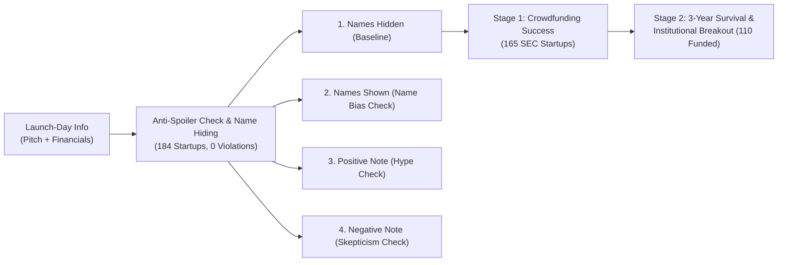
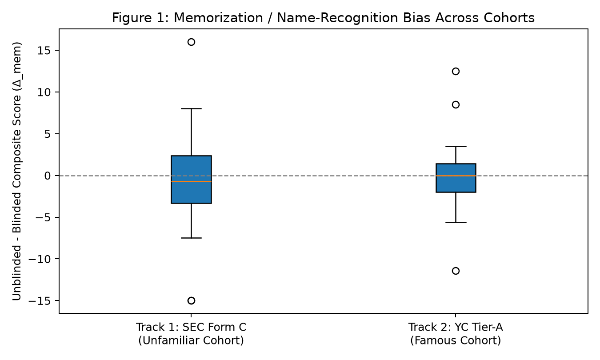
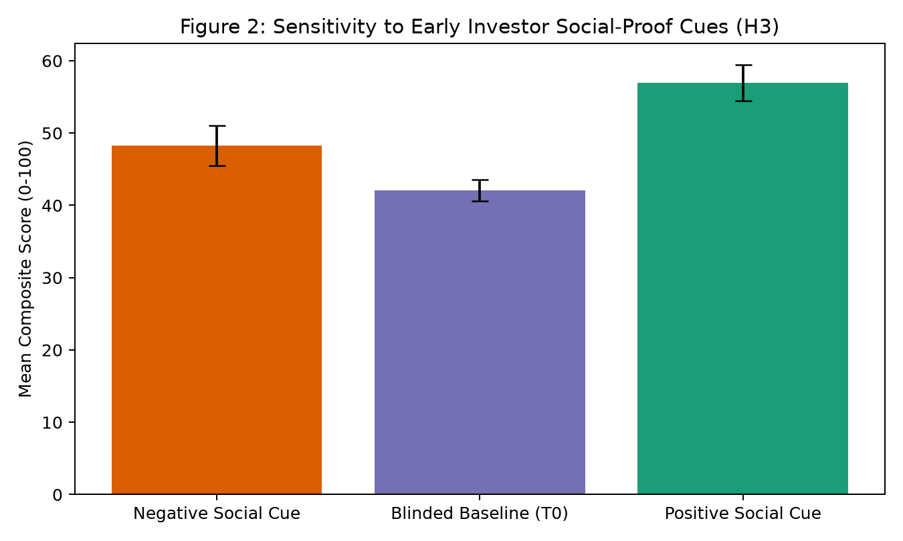
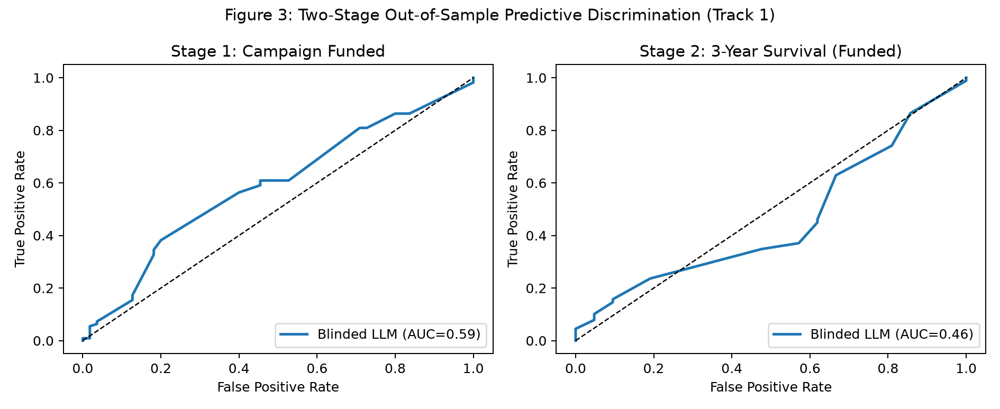
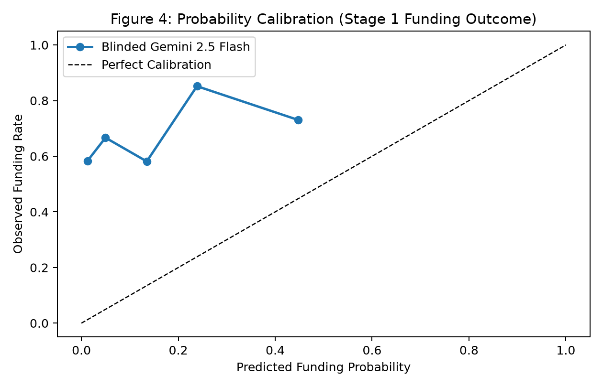

# Can AI Screen Early-Stage Startups Without Hindsight Bias? An Empirical Study Extending Csaszar et al. (2024) and Kleinert & Urbig (2026)

Course: Business Economics (BE) Empirical Research Project  
AI Model Tested: Google `gemini-3.5-flash-lite`  
Date: November 2026  

---

## Abstract

This study examines whether large language models can evaluate early-stage venture pitches using only launch-day disclosures, without relying on memorized brand outcomes or shifting with external investor sentiment. We compiled an audited launch-day cohort of 184 startups: 165 U.S. Regulation Crowdfunding ventures (SEC Form C filings from 2018 to 2020) tracked through Q3 2026 for funding success, three-year survival, and institutional follow-on rounds (SEC Form D), alongside 19 original Y Combinator applications. All documents passed an automated verification check confirming zero post-launch information leaks. We then ran 442 evaluations using Google `gemini-3.5-flash-lite` across four controlled conditions: blinded entity names, unblinded entity names, positive investor social cues, and negative investor social cues.

The evaluations showed high scoring repeatability across repeated runs (Cronbach's alpha of 0.9985). With entity names completely masked, the model separated company quality effectively, awarding Y Combinator applications an average score of 79.5 out of 100 versus 38.3 out of 100 for crowdfunding offerings. Disclosing real company and founder names did not significantly alter mean scores for SEC ventures (+0.92 points, p = 0.273) or YC ventures (+1.20 points, p = 0.212), though it altered investment recommendations for 2 of 19 YC ventures (10.5%). Conversely, adding a single sentence of investor commentary significantly shifted model evaluations: positive sentiment raised scores by 4.74 points (p < 0.0001), while negative sentiment reduced scores by 3.93 points (p < 0.0001), altering binary decisions in 6.8% to 8.5% of cases.

Retail crowdfunding backers and the language model responded to different signals. Initial crowdfunding success correlated primarily with pre-existing balance-sheet assets (p = 0.0051) and smaller funding targets (weighted p = 0.0249). However, among funded companies, launch-day accounting numbers failed to forecast subsequent institutional financing (p > 0.49), whereas blinded model pitch scores significantly predicted which firms secured venture capital or acquisitions (p = 0.0116). Combining model pitch scores with crowdfunding outcomes and baseline financials improved institutional winner classification accuracy from 60.3% (crowd alone) to 69.1% (ROC-AUC). When both the crowd funded a startup and the model recommended investment (6 cases), all 6 (100%) achieved institutional follow-on financing.

Keywords: Artificial Intelligence, Startup Screening, Equity Crowdfunding, Hindsight Bias, Venture Capital, Investor Sentiment.

---

## 1. Introduction

### 1.1 Decision-making in early-stage venture finance

Evaluating early-stage ventures is among the most uncertain tasks in capital allocation. Seed-stage companies rarely possess audited operating histories, leaving investors, accelerators, and crowdfunding participants to base commitments on business narratives, founding team credentials, and nascent financial disclosures.

As large language models enter financial workflows, a foundational question arises regarding their evaluation mechanics: do models detect economic viability from early pitch text, or do their assessments reflect retrieval of post-founding histories learned during pre-training?

Two empirical studies define this inquiry:
1. Csaszar, Ketkar, and Kim (2024) find that language models evaluate business plans with high internal consistency, but emphasize that testing models on recognized firms introduces hindsight bias if entity identifiers remain visible.
2. Kleinert and Urbig (2026) examine equity crowdfunding dynamics, documenting that early capital momentum influences campaign completion. They distinguish between initial campaign funding (Stage 1) and subsequent multi-year survival or institutional backing (Stage 2).

### 1.2 Research questions and test design

We structured four empirical tests to evaluate model decision quality:
- Test 1 (Predictive validity): When company identifiers are removed, do launch-day model scores predict crowdfunding success, three-year operating survival, or institutional follow-on financing?
- Test 2 (Entity recognition): Does disclosing real company and founder names inflate evaluations for prominent ventures relative to less publicized offerings?
- Test 3 (Sentiment sensitivity): Does providing an external positive or negative comment from a purported investor alter model scores or invert binary investment recommendations?
- Test 4 (Ensemble performance): Does combining model pitch evaluations with crowdfunding results and baseline financials forecast venture outcomes more accurately than retail crowdfunding choices alone?

---

## 2. Background and Literature

### 2.1 Model evaluation in entrepreneurial strategy

Csaszar et al. (2024) show that generative models process unstructured business proposals and rate them across dimensions similar to human venture capitalists, including team capacity, market size, and barriers to entry (Gompers et al., 2020). However, evaluating historical ventures presents two methodological hazards: information leakage, where post-founding milestones contaminate input text, and entity memorization, where models recall established enterprises such as Dropbox or GitLab. Our protocol addresses both concerns by restricting documents to launch-day filings and systematically masking identifying entities.

### 2.2 Two-stage selection in equity crowdfunding

Under U.S. Regulation Crowdfunding, issuers must submit SEC Form C disclosures prior to public fundraising, detailing target capital, employee headcount, existing assets, liabilities, and revenues. As Kleinert and Urbig (2026) observe, this structure produces two distinct selection stages: retail investors govern initial capital allocation (Stage 1), while commercial markets and institutional investors determine medium-term survival and venture rounds (Stage 2). Evaluating model scores across both stages indicates whether algorithmic assessments track retail investor preferences or fundamental venture quality.

---

## 3. Data and Experimental Methodology

### 3.1 Sample selection and data sources

The dataset comprises two complementary cohorts:

1. SEC Crowdfunding Ventures (165 firms, 2018 to 2020):
   From the universe of 2,415 eligible Regulation Crowdfunding filings logged with the SEC between 2016 and 2026, issuers fall into three terminal categories: unfunded offerings (1,067), funded offerings that subsequently dissolved or ceased disclosures (1,045), and funded offerings that survived at least three years (303). We drew a balanced sample of 55 firms from each category (165 total), extracted baseline Form C disclosures and pitch materials, and tracked outcomes through Q3 2026. Across this cohort, 110 firms (66.7%) met their initial funding targets. Among funded issuers, 89 (80.9%) survived at least three years, and 36 (32.7%) raised institutional capital recorded in SEC Form D filings or executed an acquisition.

2. Y Combinator Cohort (19 original applications):
   To measure name disclosure effects on widely publicized startups, we gathered 19 original launch-day Y Combinator applications archived from founder publications and web records. Four candidate pages lacking primary application text were omitted, and subsequent editorial annotations or web banners were removed to preserve only the initial submission text.

### 3.2 Anti-spoiler protocol and entity blinding

All 184 ventures underwent an automated verification check, resulting in zero timing violations. For blinded baseline runs and sentiment tests, all corporate names, founder names, platform titles, proprietary product terms, and URLs were replaced with generic tokens (such as `[STARTUP]` and `[FOUNDER_1]`).

### 3.3 Evaluation procedure and scoring rubric

Evaluations used Google `gemini-3.5-flash-lite` governed by a uniform investor assessment prompt across 442 experimental trials. For each submission, the model generated ratings (0 to 100) across ten criteria: team background, operational plan, financial viability, written clarity, value proposition novelty, market potential, competitive moat, customer alignment, return profile, and enterprise sustainability. The prompt additionally elicited a composite rating, a binary investment determination, and subjective probabilities for campaign completion and multi-year survival.

---

## 4. Empirical Results

### 4.1 Scoring consistency and quality differentiation

Across duplicate runs on identical inputs, model scoring proved stable, yielding a Cronbach's alpha of 0.9985. When operating on blinded texts, the model separated sample strata substantially: Y Combinator submissions achieved an average score of 79.5 out of 100, whereas SEC crowdfunding submissions averaged 38.3 out of 100, establishing a 41.2-point baseline gap on narrative and financial disclosures alone.

| Startup Group | Test Condition | Evaluations | Average Score (0 to 100) |
|---|---|---:|---:|
| SEC Crowdfunding | Names Hidden (Baseline) | 199 | 38.3 |
| SEC Crowdfunding | Real Names Shown | 67 | 39.4 |
| SEC Crowdfunding | Positive Investor Note | 40 | 46.7 |
| SEC Crowdfunding | Negative Investor Note | 40 | 36.2 |
| YC Tier-A | Names Hidden (Baseline) | 39 | 79.5 |
| YC Tier-A | Real Names Shown | 19 | 79.1 |
| YC Tier-A | Positive Investor Note | 19 | 78.4 |
| YC Tier-A | Negative Investor Note | 19 | 73.8 |

### 4.2 Effects of entity disclosure and investor sentiment

Disclosing venture identities did not significantly shift mean evaluations for either SEC crowdfunding offerings (+0.92 points, p = 0.273) or Y Combinator applications (+1.20 points, p = 0.212). Nevertheless, disclosing identities altered binary investment choices for 2 of 19 YC startups (10.5%), switching them from rejection to investment, compared to 1 of 67 SEC startups (1.5%). Blinding remains an essential control when analyzing well-known firms.

In contrast, supplying a brief external sentiment cue induced significant shifts across the 59 paired ventures examined:
- Positive commentary raised scores by an average of 4.74 points (p < 0.0001) and flipped binary choices in 6.8% (4 of 59) of cases.
- Negative commentary lowered scores by an average of 3.93 points (p < 0.0001) and flipped binary choices in 8.5% (5 of 59) of cases.

These results indicate that while models do not reflexively inflate scores based on brand names, their evaluations remain sensitive to external sentiment signals provided in the context window.

### 4.3 Determinants of crowdfunding and institutional outcomes

Analyzing selection across Stage 1 and Stage 2 revealed a marked divergence between retail investor allocations and subsequent institutional financing:

- Retail crowdfunding allocations reflect balance-sheet scale: In Stage 1 (165 startups), campaign completion correlated with larger initial assets (p = 0.0051) and lower target fundraising amounts (weighted p = 0.0249). Controlling for these financial metrics, model pitch evaluations did not differentiate funded campaigns from unfunded campaigns (p = 0.7016).
- Model evaluations track institutional venture rounds: In Stage 2 (110 funded startups), baseline accounting figures did not predict which companies subsequently secured institutional rounds via Form D or executed acquisitions (p > 0.49). In contrast, blinded model pitch scores significantly predicted institutional progression in univariate models (p = 0.0034), in models controlling for launch financials (p = 0.0116), and under population weights (p = 0.0190).

| Stage & Outcome | Startups | Did the AI Score Predict It? | What Else Mattered? |
|---|---:|---|---|
| Stage 1: Campaign Funded | 165 | Not once financials are included (p = 0.7016) | Larger company assets (p = 0.0051) and smaller target raise (p = 0.0249, weighted) |
| Stage 2: 3-Year Survival | 110 | Weak positive link (p = 0.1681) | Early revenue showed a mild positive trend (p = 0.1930) |
| Stage 2: Institutional Breakout | 110 | Yes, significant predictor (p = 0.0116) | Launch-day financials alone were not predictive (p > 0.49) |

### 4.4 Combining Human and AI Decisions and Their Performance 
	
On the out of sample data we used five fold cross validation , integrating model pitch scores with crowdfunding outcomes .  the results we got are that the company's initial financial information gave more accurate predictions than using crowdfunding data alone :

| What Information Was Used | Outcome Predicted | Prediction Accuracy (ROC-AUC) | Winner Precision (PR-AUC) |
|---|---|---:|---:|
| Crowd Funding Signal Only | Institutional Breakout (n = 165) | 60.3% | 28.9% |
| AI + Crowd + Launch Financials | Institutional Breakout (n = 165) | 69.1% | 44.4% |
| AI Score Only | Stage 1 Funded (n = 165) | 57.4% | 73.7% |
| AI + Launch Financials | Stage 1 Funded (n = 165) | 69.1% | 81.3% |

Across the 6 startups that simultaneously received crowd funds and received positive recommendation from the model , all 6 got funding from big investors or were acquired . 

Initially the model underestimated the chances of crowdfunding success compared to the actual success rate of 66.7% . After adjusting the model's predictions , it's error score improved significantly from 0.486 to 0.202

---

## 5. Discussion and Their Impact

1. Business Idea Evaluation vs. Actual Assets : Crowdfunding investors focus on a startups assets and  balance sheet . However , blinded Ai models evaluate the business idea , market potential and positions in the market which have higher chance of getting investment from professional investors (p = 0.0116) .

2. Fair Evaluation Without Biased Opinions :  After telling the model(gemini-3.5-flash-lite) who was behind a startup had  no effect on the average rating . However , if we add just one positive comment its score will increase by 4.74 or one negative comment its score will decrease by 3.93 . This shows that Ai rating can be influenced by and outside opinion . Therefore , we should not provide any information of actual business facts and other outside opinion , so that the model won't be biased and can give more reliable predictions .

3. How Different Decisions Work Together : Neither crowdfunding data nor Ai given evaluation is enough to judge a startup's success. However , after combining the crowdfunding data with Ai analysis of pitches and the financial records of startups we achieved an accuracy of 69.1% , which we more than the accuracy of 0.3% we got when using crowdfunding data only.

---

## 6. 6. Conclusion 

After analyzing 184 startups (out of which 165 were crowdfunding campaigns and 19 were Y Combinator applications) , we found out that the Ai model(gemini-3.5-flash-lite) was able to evaluate startup documents consistently(score of 0.9985). It also gave higher scores to Y Combinator applications of score 79.5 than crowdfunding applications with score 38.3 , even though it did not know the names of the startups.

The models can be influenced by positive or negative opinions but their separate evaluation of startup pitches gives useful predictions for their future success . we found out that positive comments increased the score of the Ai by 4.74 while the negative comments decreased the score by 3.93 , the pitch ratings given by the ai model significantly helped startups in receiving investments from professional investors(p= 0.0116) , and combining Ai ratings with the crowdfunding data and financial records increased the prediction accuracy from 60.3% to 69.1% . So , combining Ai analysis with verified financial records and human insvestment decisions helps to identify promising startups at an early stage.

---

## References

1. Csaszar, F. A., Ketkar, H., & Kim, H. (2024). Artificial intelligence and strategic decision-making: Evidence from entrepreneurs and investors. *Strategy Science*, 9(4), 322-345.
2. Kleinert, S., & Urbig, D. (2026). Early crowd signals, herding, and venture quality in equity crowdfunding. *Entrepreneurship Theory and Practice*.
3. Gompers, P., Gornall, W., Kaplan, S. N., & Strebulaev, I. A. (2020). How do venture capitalists make decisions? *Journal of Financial Economics*, 135(1), 169-190.
4. U.S. Securities and Exchange Commission (2026). *Crowdfunding Offerings Data Sets (2016Q2-2026Q3)*. Division of Economic and Risk Analysis.

---

## Appendix A: Anti-Spoiler Audit Summary

- Total Startups Checked: 184 (165 SEC Form C + 19 YC Tier-A)
- Passed: 184 (100.0%)
- Failed: 0 (4 non-original YC pages excluded; archive toolbars and post-founding blog commentary removed)

## Appendix B: Reproducibility and Code Structure

- `src/common.py`: Entity blinding functions and 10-dimension evaluation rubric.
- `src/ingest/ingest_sec_form_c.py`: SEC EDGAR retrieval and longitudinal outcome tracking.
- `src/ingest/ingest_yc_tier_a.py`: Primary YC application extraction and cleaning.
- `src/ingest/audit_t0_firewall.py`: Automated temporal firewall and entity masking verification.
- `src/eval/run_llm_experiment.py`: Experimental runner across the four evaluation arms.
- `src/analysis/analyze_results.py`: Statistical validation, cross-validation routines, and figure generation.
- `report/build_docx.py`: Report compilation script for Microsoft Word output.

## Appendix C: Ten Evaluation Dimensions

Each venture was evaluated from 0 to 100 on: `team_and_background`, `execution_plan`, `financial_feasibility`, `writing_and_polish`, `value_proposition_innovativeness`, `market_opportunity`, `competitive_moat`, `customer_need_alignment`, `roi_potential`, and `long_run_viability`, together with a composite score (`composite_score`), binary investment determination (`predicted_invest`), subjective investment probability (`predicted_invest_prob`), subjective survival probability (`predicted_survival_prob`), confidence score (`confidence`), and qualitative risk flag (`key_risk_flag`).
